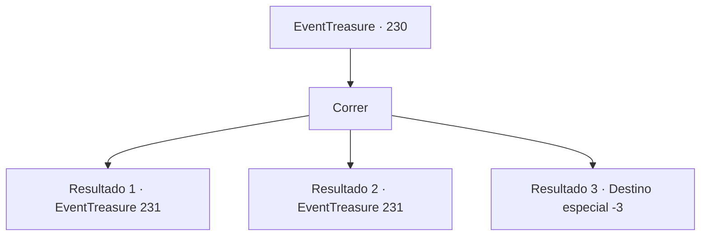

# Eventos de tesouro · 230

[Índice da tabela](index.md) · [Índice geral](../index.md)

ID: `pt:EventTreasure:230` · Fonte: `EventTreasure4` · Versão: 1.2.47.

Mapeamento estático dos arquivos; a disponibilidade e a execução dependem do estado da run.

## Texto do evento

*Sem texto no arquivo.*

## Dados de entrada

```json
{
  "id": 230,
  "grade": 1,
  "place": "",
  "required": ""
}
```

## Mapa das escolhas



## Escolhas e resultados

### Escolha 1

Correr

Requisitos e outros campos da escolha:

```json
{
  "required": ""
}
```

#### Resultado 1.1

Você começa a correr pelo caminho de terra seguindo as bandeiras. Depois de passar uma atrás da outra, você está no grupo líder, e encontra um rio no final de horas de corrida intensa. Além do poderoso rio que bloqueia seu caminho, você vê uma bandeira.

Continuação registrada: [Evento 231](0231.md) na mesma tabela.

```json
{
  "required": "",
  "chance": "1|0_6_1|0_13_1",
  "nextEvent": 231,
  "type": 0,
  "reward": ""
}
```

#### Resultado 1.2

Você começa a correr pelo caminho de terra seguindo as bandeiras. Você está sem fôlego, mas continua correndo sem desistir. Você se depara com um rio no final de horas de corrida. Além do poderoso rio que bloqueia seu caminho, você vê uma bandeira.

Continuação registrada: [Evento 231](0231.md) na mesma tabela.

```json
{
  "required": "1_0_2",
  "chance": "12",
  "nextEvent": 231,
  "type": 1,
  "reward": "0_0_-1"
}
```

#### Resultado 1.3

Você começa a correr pelo caminho de terra seguindo as bandeiras. Enquanto corre junto a uma multidão, sente algo estranho em seu coração após horas de corrida. Ao mesmo tempo, uma intensa onda de tontura te envolve. Depois de cair no chão, você exala seu último suspiro.

Continuação registrada: [Destino especial `-3`](../destinos-especiais.md).

```json
{
  "required": "2_0_2",
  "chance": "12",
  "nextEvent": -3,
  "type": 1,
  "reward": "0_0_-1"
}
```

## Referências que chegam a este evento

- [Evento 229 · escolha 1 · resultado 1](0229.md#escolha-1)
