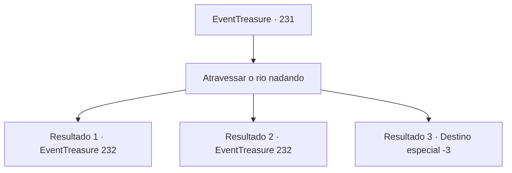

# Eventos de tesouro · 231

[Índice da tabela](index.md) · [Índice geral](../index.md)

ID: `pt:EventTreasure:231` · Fonte: `EventTreasure4` · Versão: 1.2.47.

Mapeamento estático dos arquivos; a disponibilidade e a execução dependem do estado da run.

## Texto do evento

*Sem texto no arquivo.*

## Dados de entrada

```json
{
  "id": 231,
  "grade": 1,
  "place": "",
  "required": ""
}
```

## Mapa das escolhas



## Escolhas e resultados

### Escolha 1

Atravessar o rio nadando

Requisitos e outros campos da escolha:

```json
{
  "required": ""
}
```

#### Resultado 1.1

Você pula no rio e começa a nadar. O rio era muito largo, mas não foi um grande problema para você. 

 Depois de chegar ao rio, você olha ao redor e percebe que outros participantes também estão chegando ao rio. Você começa a seguir as bandeiras novamente. Depois de um tempo, um alto paredão de rocha se interpõe em seu caminho desta vez.

Continuação registrada: [Evento 232](0232.md) na mesma tabela.

```json
{
  "required": "",
  "chance": "1|0_5_1|0_13_1",
  "nextEvent": 232,
  "type": 0,
  "reward": ""
}
```

#### Resultado 1.2

Você pula no rio e começa a nadar. Devido ao rio ser tão largo, você teve que nadar por quase uma hora. 

 Finalmente, você chega à margem depois de mover seus membros por um tempo. É mais preciso dizer que você foi levado pela correnteza em vez de nadar. Olhando ao redor, você vê alguns outros participantes exaustos chegando à margem. Você começa a seguir as bandeiras novamente. Depois de um tempo, uma alta parede de rocha bloqueia seu caminho desta vez.

Continuação registrada: [Evento 232](0232.md) na mesma tabela.

```json
{
  "required": "1_0_2",
  "chance": "15",
  "nextEvent": 232,
  "type": 1,
  "reward": "0_0_-1"
}
```

#### Resultado 1.3

Você pula no rio e começa a nadar. O rio é muito largo com correntezas ferozes, e eventualmente, o rio te arrasta.

Continuação registrada: [Destino especial `-3`](../destinos-especiais.md).

```json
{
  "required": "2_0_2",
  "chance": "15",
  "nextEvent": -3,
  "type": 1,
  "reward": "0_0_-1"
}
```

## Referências que chegam a este evento

- [Evento 230 · escolha 1 · resultado 1](0230.md#escolha-1)
- [Evento 230 · escolha 1 · resultado 2](0230.md#escolha-1)
