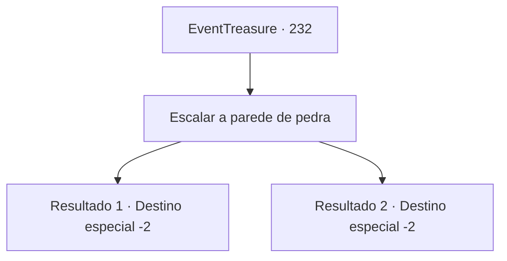

# Eventos de tesouro · 232

[Índice da tabela](index.md) · [Índice geral](../index.md)

ID: `pt:EventTreasure:232` · Fonte: `EventTreasure4` · Versão: 1.2.47.

Mapeamento estático dos arquivos; a disponibilidade e a execução dependem do estado da run.

## Texto do evento

*Sem texto no arquivo.*

## Dados de entrada

```json
{
  "id": 232,
  "grade": 1,
  "place": "",
  "required": ""
}
```

## Mapa das escolhas



## Escolhas e resultados

### Escolha 1

Escalar a parede de pedra

Requisitos e outros campos da escolha:

```json
{
  "required": ""
}
```

#### Resultado 1.1

Você começa a escalar a parede de rocha. Você escala a parede de rocha mais rápido do que qualquer um e assume a liderança, porque as outras pessoas, que chegaram antes de você, não conseguiram aumentar sua velocidade. Depois de chegar ao topo da parede de rocha, você cruza a linha de chegada e levanta a bandeira. Então, a recepcionista ao seu lado aplaude e diz: 

 "Parabéns! Você é o vencedor desta competição!"

 Após o término da competição, você retorna a Altena e participa da cerimônia de premiação. Os cidadãos se reúnem para te parabenizar, e os anfitriões da competição te entregam o dinheiro do prêmio e o troféu. 

 "O vencedor da 86ª competição Iron Man, {1}! Por favor, aplaudam!"

 Você levanta o troféu diante dos aplausos dos cidadãos. Assim, após a competição, você é chamado de 'Iron Man'. Você, junto com os outros participantes do torneio, relaxa desfrutando das bebidas e comidas preparadas.

Continuação registrada: [Destino especial `-2`](../destinos-especiais.md).

```json
{
  "required": "",
  "chance": "1|0_5_1|0_13_1",
  "nextEvent": -2,
  "type": 0,
  "reward": "27_26_1|0_4_150|0_0_1|0_1_1|0_2_1"
}
```

#### Resultado 1.2

Você começa a escalar a parede de rocha. No entanto, no final, é outra pessoa quem cruza a linha de chegada no seu lugar. Há um festival na cidade após a competição. Você, junto com os outros participantes do torneio, relaxa aproveitando as bebidas e comidas preparadas.

Continuação registrada: [Destino especial `-2`](../destinos-especiais.md).

```json
{
  "required": "",
  "chance": "18",
  "nextEvent": -2,
  "type": 1,
  "reward": "5_529_9|0_0_1|0_1_1"
}
```

## Referências que chegam a este evento

- [Evento 231 · escolha 1 · resultado 1](0231.md#escolha-1)
- [Evento 231 · escolha 1 · resultado 2](0231.md#escolha-1)
