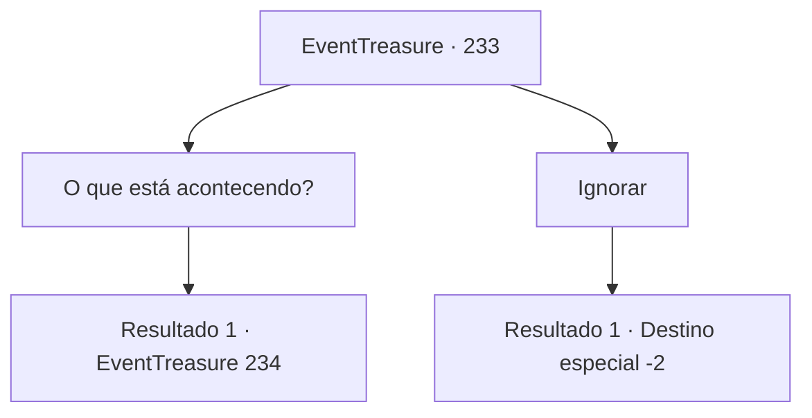

# Eventos de tesouro · 233

[Índice da tabela](index.md) · [Índice geral](../index.md)

ID: `pt:EventTreasure:233` · Fonte: `EventTreasure4` · Versão: 1.2.47.

Mapeamento estático dos arquivos; a disponibilidade e a execução dependem do estado da run.

## Texto do evento

Enquanto você passa por uma pequena vila chamada ‘Lineh’, você encontra duas mulheres gritando e brigando. Debaixo de uma grande árvore na entrada da aldeia, eles brigam com uma criança no meio, e cada uma delas está dizendo que o filho é delas. Os aldeões estão todos olhando para eles e murmurando: e um velho, que se parece com o chefe da aldeia, está no meio, parecendo descontente.

## Dados de entrada

```json
{
  "id": 233,
  "grade": 2,
  "place": "",
  "required": "5_531_0|26_7_1|1_2_50"
}
```

## Mapa das escolhas



## Escolhas e resultados

### Escolha 1

O que está acontecendo?

Requisitos e outros campos da escolha:

```json
{
  "required": ""
}
```

#### Resultado 1.1

Você se aproxima do idoso e pergunta o que está acontecendo. Então ele solta um suspiro profundo e responde. 

 "Uf... Essas duas mulheres dizem que o menino é filho delas. Mas não sei como resolver essa discussão, já que não há maneira de saber..."


Continuação registrada: [Evento 234](0234.md) na mesma tabela.

```json
{
  "required": "",
  "chance": "1",
  "nextEvent": 234,
  "type": 2,
  "reward": "5_531_1"
}
```

### Escolha 2

Ignorar

Requisitos e outros campos da escolha:

```json
{
  "required": ""
}
```

#### Resultado 2.1

Você ignora a briga e segue seu rumo.

Continuação registrada: [Destino especial `-2`](../destinos-especiais.md).

```json
{
  "required": "",
  "chance": "1",
  "nextEvent": -2,
  "type": 2,
  "reward": "5_531_9"
}
```

## Referências que chegam a este evento

Nenhum `nextEvent` positivo da mesma tabela aponta para este nó. Isso não prova que seja inacessível: sorteio e estado de história podem selecioná-lo.

