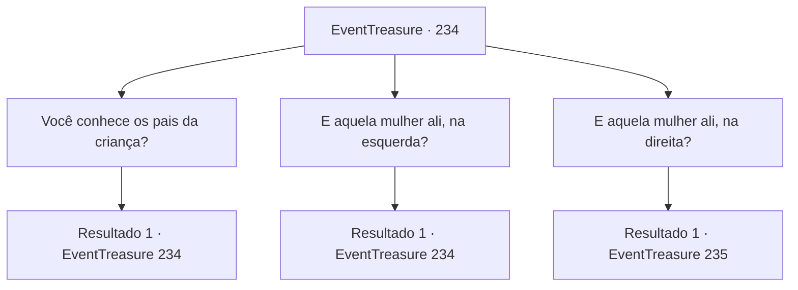

# Eventos de tesouro · 234

[Índice da tabela](index.md) · [Índice geral](../index.md)

ID: `pt:EventTreasure:234` · Fonte: `EventTreasure4` · Versão: 1.2.47.

Mapeamento estático dos arquivos; a disponibilidade e a execução dependem do estado da run.

## Texto do evento

*Sem texto no arquivo.*

## Dados de entrada

```json
{
  "id": 234,
  "grade": 1,
  "place": "",
  "required": ""
}
```

## Mapa das escolhas



## Escolhas e resultados

### Escolha 1

Você conhece os pais da criança?

Requisitos e outros campos da escolha:

```json
{
  "required": "5_533_0"
}
```

#### Resultado 1.1

Você pergunta ao chefe se ele conhece o pai da criança, mas ele nega com a cabeça. Infelizmente, os suspeitos de serem os pais da criança são 'Toms' e 'Jericho', mas ambos já estão mortos. Isso aconteceu quando um monstro atacou há alguns meses.

Continuação registrada: [Evento 234](0234.md) na mesma tabela.

```json
{
  "required": "",
  "chance": "1",
  "nextEvent": 234,
  "type": 2,
  "reward": "5_533_1"
}
```

### Escolha 2

E aquela mulher ali, na esquerda?

Requisitos e outros campos da escolha:

```json
{
  "required": "5_534_0"
}
```

#### Resultado 2.1

Quando você pergunta sobre a mulher que está em pé à esquerda da criança, ela se aproxima de você e se apresenta. 

 "Oh... sábio aventureiro! Por favor, nos diga a verdade! Eu sou 'Arne'. Cresci nesta vila. Mas essa estrangeira de repente afirma que meu filho é dela."

 Segundo ela, a criança pertence a ela e a 'Toms' e a mulher à direita está dizendo que ela está mentindo.

Continuação registrada: [Evento 234](0234.md) na mesma tabela.

```json
{
  "required": "",
  "chance": "1",
  "nextEvent": 234,
  "type": 2,
  "reward": "5_534_1"
}
```

### Escolha 3

E aquela mulher ali, na direita?

Requisitos e outros campos da escolha:

```json
{
  "required": "5_535_0|5_534_1"
}
```

#### Resultado 3.1

Quando perguntas sobre a mulher que está em pé ao lado direito da criança, o idoso responde. 

 "Ela é 'Luna' que chegou a esta cidade há alguns meses. Ela vivia nesta cidade com seu marido Jericho. E ela já estava grávida naquele tempo."

 Segundo o idoso, ambas as mulheres estavam grávidas, e o tempo estimado de parto também era semelhante.

Continuação registrada: [Evento 235](0235.md) na mesma tabela.

```json
{
  "required": "",
  "chance": "1",
  "nextEvent": 235,
  "type": 2,
  "reward": "5_535_1"
}
```

## Referências que chegam a este evento

- [Evento 233 · escolha 1 · resultado 1](0233.md#escolha-1)
- [Evento 234 · escolha 1 · resultado 1](0234.md#escolha-1)
- [Evento 234 · escolha 2 · resultado 1](0234.md#escolha-2)
