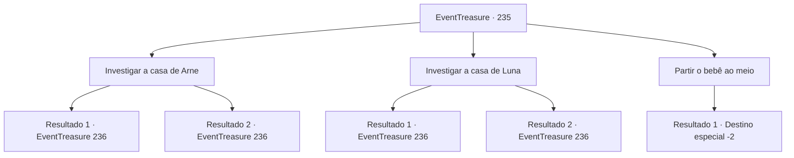

# Eventos de tesouro · 235

[Índice da tabela](index.md) · [Índice geral](../index.md)

ID: `pt:EventTreasure:235` · Fonte: `EventTreasure4` · Versão: 1.2.47.

Mapeamento estático dos arquivos; a disponibilidade e a execução dependem do estado da run.

## Texto do evento

*Sem texto no arquivo.*

## Dados de entrada

```json
{
  "id": 235,
  "grade": 1,
  "place": "",
  "required": ""
}
```

## Mapa das escolhas



## Escolhas e resultados

### Escolha 1

Investigar a casa de Arne

Requisitos e outros campos da escolha:

```json
{
  "required": "5_536_0"
}
```

#### Resultado 1.1

Decide investigar a casa de Arne. Em sua pequena cabana, há uma vela usada na mesa de jantar, uma vassoura para varrer o pátio, uma lareira comum, uma cama coberta com um tecido áspero e mais. Pode parecer uma casa normal por fora, mas você percebe que não há objetos relacionados a bebês depois de olhar ao redor da casa.

Continuação registrada: [Evento 236](0236.md) na mesma tabela.

```json
{
  "required": "",
  "chance": "1|0_14_1",
  "nextEvent": 236,
  "type": 2,
  "reward": "5_536_2"
}
```

#### Resultado 1.2

Decide investigar a casa de Arne. Em sua pequena cabana, há uma vela usada na mesa de jantar, uma vassoura para varrer o pátio, uma lareira comum, uma cama coberta com um tecido áspero e mais. Por fora, parece uma casa normal.

Continuação registrada: [Evento 236](0236.md) na mesma tabela.

```json
{
  "required": "",
  "chance": "12",
  "nextEvent": 236,
  "type": 2,
  "reward": "5_536_1"
}
```

### Escolha 2

Investigar a casa de Luna

Requisitos e outros campos da escolha:

```json
{
  "required": "5_537_0"
}
```

#### Resultado 2.1

Decide investigar a casa de Luna. A cabana de Luna está tão arrumada que é difícil encontrar vestígios de poeira na mesa de jantar e na cozinha. Na parede, há uma espada e um escudo que parecem ter pertencido ao seu marido, há também uma pequena cama para seu bebê em seu quarto.

Continuação registrada: [Evento 236](0236.md) na mesma tabela.

```json
{
  "required": "",
  "chance": "1|0_14_1",
  "nextEvent": 236,
  "type": 2,
  "reward": "5_537_1"
}
```

#### Resultado 2.2

Decide investigar a casa de Luna. A cabana de Luna está tão arrumada que é difícil encontrar vestígios de poeira na mesa de jantar e na cozinha. No entanto, além disso, é apenas uma casa comum sem nada especialmente especial.

Continuação registrada: [Evento 236](0236.md) na mesma tabela.

```json
{
  "required": "",
  "chance": "12",
  "nextEvent": 236,
  "type": 2,
  "reward": "5_537_2"
}
```

### Escolha 3

Partir o bebê ao meio

Requisitos e outros campos da escolha:

```json
{
  "required": "1_14_18"
}
```

#### Resultado 3.1

Você pede ao chefe da vila para trazer uma machadinha. Depois de pegar a machadinha, você diz a eles que irá dividir o bebê ao meio e cada uma irá ficar com uma parte. Então Arne concorda com a cabeça. 

 "Ótimo. Isso deve funcionar."

 Então Luna te agarra pelo pescoço e grita. 

 "Você está louco?! Eu... eu simplesmente desisto."

 Ela cai no chão chorando. Depois de ver isso, o chefe fala com voz séria. 

 "Entendo... Este é o filho de Luna. Arne, pare de fazer bobagens."

 Então ele vem e te agarra pela mão. 

 "Você é realmente sábio... Não é muito, mas isso deve expressar minha gratidão. Tome isso."

 O chefe te entrega um pouco de ouro e uma machadinha como sinal de gratidão. Você se despede e deixa a vila.

Continuação registrada: [Destino especial `-2`](../destinos-especiais.md).

```json
{
  "required": "",
  "chance": "1",
  "nextEvent": -2,
  "type": 2,
  "reward": "0_4_30|3_257_1|27_27_1|5_531_9|0_2_1"
}
```

## Referências que chegam a este evento

- [Evento 234 · escolha 3 · resultado 1](0234.md#escolha-3)
