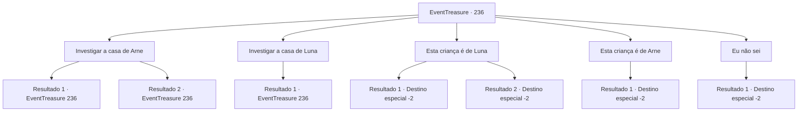

# Eventos de tesouro · 236

[Índice da tabela](index.md) · [Índice geral](../index.md)

ID: `pt:EventTreasure:236` · Fonte: `EventTreasure4` · Versão: 1.2.47.

Mapeamento estático dos arquivos; a disponibilidade e a execução dependem do estado da run.

## Texto do evento

*Sem texto no arquivo.*

## Dados de entrada

```json
{
  "id": 236,
  "grade": 1,
  "place": "",
  "required": ""
}
```

## Mapa das escolhas



## Escolhas e resultados

### Escolha 1

Investigar a casa de Arne

Requisitos e outros campos da escolha:

```json
{
  "required": "5_536_0"
}
```

#### Resultado 1.1

Decide investigar a casa de Arne. Em sua pequena cabana, há uma vela usada na mesa de jantar, uma vassoura para varrer o pátio, uma lareira comum, uma cama coberta com um tecido áspero e mais. Pode parecer uma casa normal por fora, mas você percebe que não há objetos relacionados a bebês depois de olhar ao redor da casa.

Continuação registrada: [Evento 236](0236.md) na mesma tabela.

```json
{
  "required": "",
  "chance": "1|0_14_1",
  "nextEvent": 236,
  "type": 0,
  "reward": "5_536_2"
}
```

#### Resultado 1.2

Decide investigar a casa de Arne. Em sua pequena cabana, há uma vela usada na mesa de jantar, uma vassoura para varrer o pátio, uma lareira comum, uma cama coberta com um tecido áspero e mais. Por fora, parece uma casa normal.

Continuação registrada: [Evento 236](0236.md) na mesma tabela.

```json
{
  "required": "",
  "chance": "12",
  "nextEvent": 236,
  "type": 1,
  "reward": "5_536_1"
}
```

### Escolha 2

Investigar a casa de Luna

Requisitos e outros campos da escolha:

```json
{
  "required": "5_537_0"
}
```

#### Resultado 2.1

Decide investigar a casa de Luna. A cabana de Luna está tão arrumada que é difícil encontrar vestígios de poeira na mesa de jantar e na cozinha. Na parede, há uma espada e um escudo que parecem ter pertencido ao seu marido, há também uma pequena cama para seu bebê em seu quarto.

Continuação registrada: [Evento 236](0236.md) na mesma tabela.

```json
{
  "required": "",
  "chance": "1",
  "nextEvent": 236,
  "type": 0,
  "reward": "5_537_1"
}
```

### Escolha 3

Esta criança é de Luna

Requisitos e outros campos da escolha:

```json
{
  "required": ""
}
```

#### Resultado 3.1

Você diz que o bebê é filho da Luna. Então Arne corre em sua direção e te agarra pelo pescoço. -O que você sabe?! Tem provas?! Eu te digo que esse é meu bebê! Mas quando você diz que não encontrou nada relacionado a um bebê em sua casa, os aldeões também concordam com a cabeça. Depois de ver isso, o chefe fala com voz séria. -Entendo... Esse criança é filho da Luna. Arne, pare de falar besteiras. Então ele vem e te agarra pela mão. -Obrigado por sua ajuda. Depois de te ouvir, posso ver que o bebê é definitivamente filho da Luna. Não é muito, mas devo expressar minha gratidão. Tome isso. O chefe te entrega um pouco de ouro como forma de gratidão. Você se despede e deixa a vila.

Continuação registrada: [Destino especial `-2`](../destinos-especiais.md).

```json
{
  "required": "5_536_2",
  "chance": "1",
  "nextEvent": -2,
  "type": 2,
  "reward": "0_4_30|27_33_1|5_531_9|0_2_1"
}
```

#### Resultado 3.2

Você diz que o bebê é filho da Lua. Então Arne corre em sua direção e te agarra pelo pescoço. 

 "O que você sabe?! Tem provas? Eu te digo que esse é meu bebê!"

 Depois que ela grita várias vezes, alguns aldeões ficam do lado dela. Dizem que seus argumentos estão mal fundamentados e gritam dizendo que um estranho como você não deve se intrometer em seus assuntos. Ao perceber que a discussão sobre o bebê não vai acabar tão cedo, você deixa a vila e segue para outro lugar.

Continuação registrada: [Destino especial `-2`](../destinos-especiais.md).

```json
{
  "required": "18_536_2",
  "chance": "1",
  "nextEvent": -2,
  "type": 2,
  "reward": "5_531_9"
}
```

### Escolha 4

Esta criança é de Arne

Requisitos e outros campos da escolha:

```json
{
  "required": "18_536_2"
}
```

#### Resultado 4.1

Você diz que o bebê é filho de Arne. Então Luna corre em sua direção e te agarra pelo pescoço. 

 "Pare de mentir! Esse bebê é meu...!"

 Enquanto ela começa a gritar, os aldeões a afastam de você. Depois que Luna é arrastada para fora da vila, Arne expressa sua gratidão. 

 "Obrigado pela sua ajuda. Isso foi resolvido graças a você."

 Ela te entrega um pouco de ouro como sinal de gratidão.

Continuação registrada: [Destino especial `-2`](../destinos-especiais.md).

```json
{
  "required": "",
  "chance": "1",
  "nextEvent": -2,
  "type": 2,
  "reward": "0_4_50|5_531_2"
}
```

### Escolha 5

Eu não sei

Requisitos e outros campos da escolha:

```json
{
  "required": ""
}
```

#### Resultado 5.1

Você diz que não sabe e foge rapidamente da cidade.

Continuação registrada: [Destino especial `-2`](../destinos-especiais.md).

```json
{
  "required": "",
  "chance": "1",
  "nextEvent": -2,
  "type": 2,
  "reward": "5_531_9"
}
```

## Referências que chegam a este evento

- [Evento 235 · escolha 1 · resultado 1](0235.md#escolha-1)
- [Evento 235 · escolha 1 · resultado 2](0235.md#escolha-1)
- [Evento 235 · escolha 2 · resultado 1](0235.md#escolha-2)
- [Evento 235 · escolha 2 · resultado 2](0235.md#escolha-2)
- [Evento 236 · escolha 1 · resultado 1](0236.md#escolha-1)
- [Evento 236 · escolha 1 · resultado 2](0236.md#escolha-1)
- [Evento 236 · escolha 2 · resultado 1](0236.md#escolha-2)
