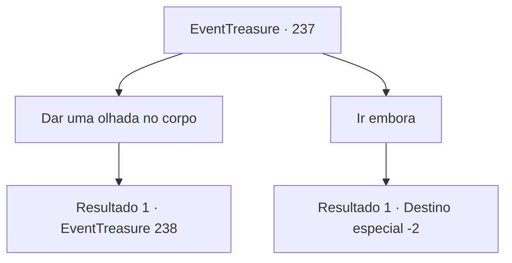

# Eventos de tesouro · 237

[Índice da tabela](index.md) · [Índice geral](../index.md)

ID: `pt:EventTreasure:237` · Fonte: `EventTreasure4` · Versão: 1.2.47.

Mapeamento estático dos arquivos; a disponibilidade e a execução dependem do estado da run.

## Texto do evento

Você passa por ‘Lineh’ que você visitou antes. Olhando para a grande árvore na entrada da aldeia, você percebe que algo está diferente de antes. Uma mulher estava enforcada na árvore. |drawing_hangTree|

## Dados de entrada

```json
{
  "id": 237,
  "grade": 1,
  "place": "",
  "required": "5_531_2|2_3_-14"
}
```

## Mapa das escolhas



## Escolhas e resultados

### Escolha 1

Dar uma olhada no corpo

Requisitos e outros campos da escolha:

```json
{
  "required": ""
}
```

#### Resultado 1.1

À medida que te aproximas, percebes que a mulher é 'Luna', com quem discutiste antes sobre o bebê. 

 "Desculpa. Aventureiro."

 Nesse momento, alguém te chama de trás. Quando te viras, Arne, que estava discutindo com Luna sobre o bebê, está lá parado. 

 "Você poderia, por favor... se livrar desse cadáver?"


Continuação registrada: [Evento 238](0238.md) na mesma tabela.

```json
{
  "required": "",
  "chance": "1",
  "nextEvent": 238,
  "type": 2,
  "reward": ""
}
```

### Escolha 2

Ir embora

Requisitos e outros campos da escolha:

```json
{
  "required": ""
}
```

#### Resultado 2.1

Você percebe que a mulher é 'Luna', que discutiu pelo bebê antes. Então você se vira rapidamente e sai de lá.

Continuação registrada: [Destino especial `-2`](../destinos-especiais.md).

```json
{
  "required": "",
  "chance": "1",
  "nextEvent": -2,
  "type": 2,
  "reward": "5_531_9"
}
```

## Referências que chegam a este evento

Nenhum `nextEvent` positivo da mesma tabela aponta para este nó. Isso não prova que seja inacessível: sorteio e estado de história podem selecioná-lo.

