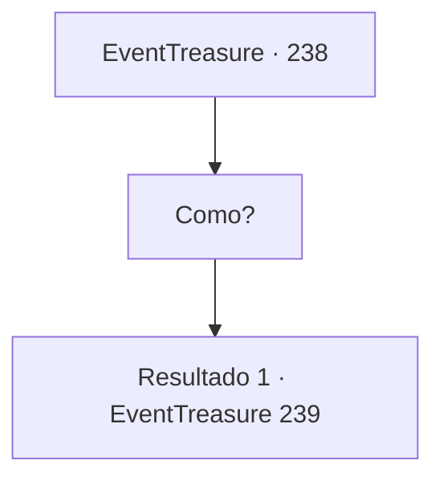

# Eventos de tesouro · 238

[Índice da tabela](index.md) · [Índice geral](../index.md)

ID: `pt:EventTreasure:238` · Fonte: `EventTreasure4` · Versão: 1.2.47.

Mapeamento estático dos arquivos; a disponibilidade e a execução dependem do estado da run.

## Texto do evento

*Sem texto no arquivo.*

## Dados de entrada

```json
{
  "id": 238,
  "grade": 1,
  "place": "",
  "required": ""
}
```

## Mapa das escolhas



## Escolhas e resultados

### Escolha 1

Como?

Requisitos e outros campos da escolha:

```json
{
  "required": ""
}
```

#### Resultado 1.1

Quando você pergunta como ela grita com uma voz aguda. <link=shake>

 "Não importa como! Não me importa se você a arrasta e a queima, a corta em pedaços e a joga no rio, ou cava um buraco e a enterra! Faça algo!"

</link> Depois de gritar com as veias inchadas em seu pescoço, ela fica surpresa com o quão alto acabou de gritar. Ela continua enquanto começa a tremer. 

 "D-Desculpe. Tem sido tão difícil ultimamente... Isso, isso está me deixando louca. Por favor, me ajude."


Continuação registrada: [Evento 239](0239.md) na mesma tabela.

```json
{
  "required": "",
  "chance": "1",
  "nextEvent": 239,
  "type": 2,
  "reward": ""
}
```

## Referências que chegam a este evento

- [Evento 237 · escolha 1 · resultado 1](0237.md#escolha-1)
