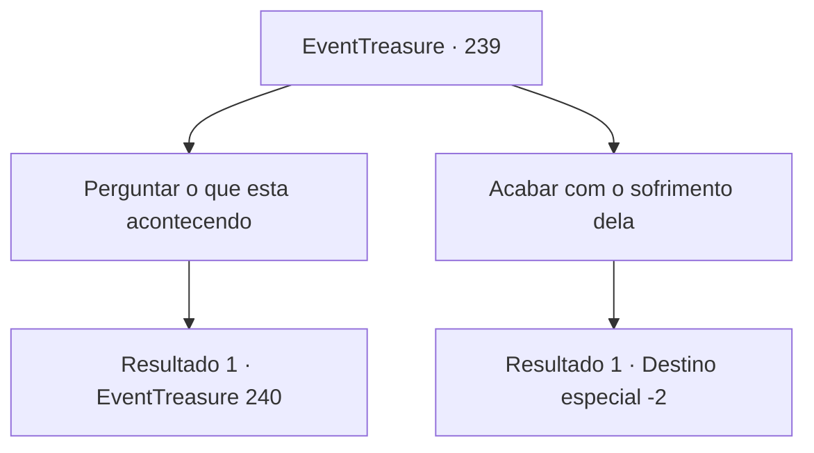

# Eventos de tesouro · 239

[Índice da tabela](index.md) · [Índice geral](../index.md)

ID: `pt:EventTreasure:239` · Fonte: `EventTreasure4` · Versão: 1.2.47.

Mapeamento estático dos arquivos; a disponibilidade e a execução dependem do estado da run.

## Texto do evento

*Sem texto no arquivo.*

## Dados de entrada

```json
{
  "id": 239,
  "grade": 1,
  "place": "",
  "required": ""
}
```

## Mapa das escolhas



## Escolhas e resultados

### Escolha 1

Perguntar o que esta acontecendo

Requisitos e outros campos da escolha:

```json
{
  "required": ""
}
```

#### Resultado 1.1

Arne aponta para o cadáver pendurado na árvore. 

 "Luna... Essa mulher está me incomodando. Ela vem até mim todas as noites e sussurra no meu ouvido, pedindo para eu devolver o bebê dela. Consigo ouvir seus sussurros mesmo quando fecho meus ouvidos."

 Ele diz que tentou tirar o cadáver de Luna da árvore com a ajuda dos aldeões, mas os aldeões nem sequer se aproximaram porque tinham medo de serem amaldiçoados por Luna.

Continuação registrada: [Evento 240](0240.md) na mesma tabela.

```json
{
  "required": "",
  "chance": "1",
  "nextEvent": 240,
  "type": 2,
  "reward": ""
}
```

### Escolha 2

Acabar com o sofrimento dela

Requisitos e outros campos da escolha:

```json
{
  "required": "2_3_-14"
}
```

#### Resultado 2.1

Inventas a maneira mais fácil e rápida de acabar com o seu sofrimento. E você a coloca em ação. Você a golpeia e ela para de respirar, finalmente liberta do seu sofrimento. Depois de jogar o corpo dela debaixo da grande árvore, você segue para outro lugar.

Continuação registrada: [Destino especial `-2`](../destinos-especiais.md).

```json
{
  "required": "",
  "chance": "1",
  "nextEvent": -2,
  "type": 2,
  "reward": "5_531_9|0_3_-5"
}
```

## Referências que chegam a este evento

- [Evento 238 · escolha 1 · resultado 1](0238.md#escolha-1)
