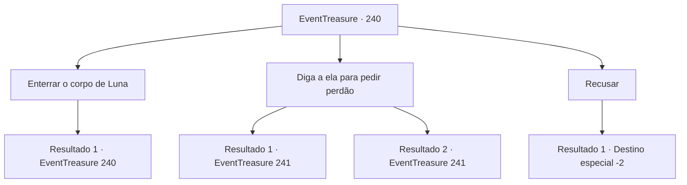

# Eventos de tesouro · 240

[Índice da tabela](index.md) · [Índice geral](../index.md)

ID: `pt:EventTreasure:240` · Fonte: `EventTreasure4` · Versão: 1.2.47.

Mapeamento estático dos arquivos; a disponibilidade e a execução dependem do estado da run.

## Texto do evento

*Sem texto no arquivo.*

## Dados de entrada

```json
{
  "id": 240,
  "grade": 1,
  "place": "",
  "required": ""
}
```

## Mapa das escolhas



## Escolhas e resultados

### Escolha 1

Enterrar o corpo de Luna

Requisitos e outros campos da escolha:

```json
{
  "required": "5_538_0"
}
```

#### Resultado 1.1

Você tenta descer o cadáver de Luna da árvore. No entanto, mesmo a corda pendurada na árvore não se move como se estivesse segurando e não a deixasse ir. Você não consegue descer o cadáver dela. Depois de ver isso, Arne começa a tremer com os dentes batendo de terror.

Continuação registrada: [Evento 240](0240.md) na mesma tabela.

```json
{
  "required": "",
  "chance": "1",
  "nextEvent": 240,
  "type": 2,
  "reward": "5_538_1"
}
```

### Escolha 2

Diga a ela para pedir perdão

Requisitos e outros campos da escolha:

```json
{
  "required": "5_538_1"
}
```

#### Resultado 2.1

Você diz a Arne para implorar perdão. Em seguida, seus olhos se voltam lentamente para o cadáver de Luna enquanto ela fica muito cautelosa com você. Depois, ela cai de joelhos e se deita no chão. 

 "Eu errei. Luna. Por favor... Me perdoe. Vou criar o bebê. Ela não pode viver sem mim. Você sabe disso."

 Mas quando nada acontece, Arne levanta a cabeça e te olha. 

 "Espera, agora que penso nisso, você também estava do meu lado naquela época. Não faz sentido que apenas eu tenha que implorar perdão."

 Ele acrescenta que você também precisa implorar perdão para aliviar o coração de Luna.

Continuação registrada: [Evento 241](0241.md) na mesma tabela.

```json
{
  "required": "",
  "chance": "1|0_12_1",
  "nextEvent": 241,
  "type": 0,
  "reward": ""
}
```

#### Resultado 2.2

Você diz a Arne para implorar perdão. Então ela diz que não fez nada de errado, e grita com você, dizendo para não falar bobagens. Então ela continua gritando. 

 "Espera, você também pegou minha parte naquela época. Não faz sentido eu ser a única que tenha que implorar perdão."


Continuação registrada: [Evento 241](0241.md) na mesma tabela.

```json
{
  "required": "",
  "chance": "16",
  "nextEvent": 241,
  "type": 1,
  "reward": ""
}
```

### Escolha 3

Recusar

Requisitos e outros campos da escolha:

```json
{
  "required": ""
}
```

#### Resultado 3.1

Você rejeita o pedido de Arne. Ela implora para que você cuide disso de qualquer maneira necessária, mas você se afasta dela e começa a caminhar.

Continuação registrada: [Destino especial `-2`](../destinos-especiais.md).

```json
{
  "required": "",
  "chance": "1",
  "nextEvent": -2,
  "type": 2,
  "reward": "5_531_9"
}
```

## Referências que chegam a este evento

- [Evento 239 · escolha 1 · resultado 1](0239.md#escolha-1)
- [Evento 240 · escolha 1 · resultado 1](0240.md#escolha-1)
