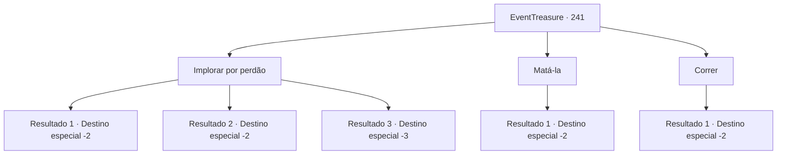

# Eventos de tesouro · 241

[Índice da tabela](index.md) · [Índice geral](../index.md)

ID: `pt:EventTreasure:241` · Fonte: `EventTreasure4` · Versão: 1.2.47.

Mapeamento estático dos arquivos; a disponibilidade e a execução dependem do estado da run.

## Texto do evento

*Sem texto no arquivo.*

## Dados de entrada

```json
{
  "id": 241,
  "grade": 1,
  "place": "",
  "required": ""
}
```

## Mapa das escolhas



## Escolhas e resultados

### Escolha 1

Implorar por perdão

Requisitos e outros campos da escolha:

```json
{
  "required": ""
}
```

#### Resultado 1.1

Você concorda com o que Arne diz com um aceno de cabeça e se ajoelha ao lado dele. Então você começa a lamentar a morte de Luna e se desculpa. Nesse momento, você ouve um sussurro. 

 "Estou horrorizado... Não é justo... É... é meu filho...!"

 Ao mesmo tempo, uma dor aguda como unhas ásperas que te arranham cobre seu corpo. No entanto, você não cede à dor e continua se desculpando de joelhos. O sussurro fica cada vez mais alto, mas desaparece depois de um tempo. Você levanta a cabeça e olha para o lado para encontrar o cadáver de Luna caído sobre Arne. Arne está morto com espuma na boca. Você expressa suas condolências e segue para outro lugar.

Continuação registrada: [Destino especial `-2`](../destinos-especiais.md).

```json
{
  "required": "",
  "chance": "1|0_14_1",
  "nextEvent": -2,
  "type": 0,
  "reward": "5_531_9|0_3_3"
}
```

#### Resultado 1.2

Você aceita o que Arne diz com um gesto de concordância e se ajoelha ao lado dela. Então você começa a lamentar a morte de Luna e se desculpa. Nesse momento, você ouve um sussurro. 

 "Estou horrorizado... Não é justo... É... é meu filho...!"

 Ao mesmo tempo, uma dor aguda como unhas ásperas que arranham cobre seu corpo. Você se levanta gritando porque não consegue suportar a dor. E o mesmo acontece com Arne. Nesse momento, o cadáver de Luna cai sobre você e Arne. A carne podre e os fluidos corporais respingam com um mau cheiro, e você sai correndo gritando.

Continuação registrada: [Destino especial `-2`](../destinos-especiais.md).

```json
{
  "required": "1_1_2",
  "chance": "16",
  "nextEvent": -2,
  "type": 1,
  "reward": "5_531_9|0_1_-1"
}
```

#### Resultado 1.3

Você aceita o que Arne diz com um gesto de concordância e se ajoelha ao lado dela. Então você começa a lamentar a morte de Luna e se desculpa. Nesse momento, você ouve um sussurro. 

 "Estou horrorizado... Não é justo... É... é meu filho...!"

 Ao mesmo tempo, uma dor aguda como unhas ásperas que arranham cobre seu corpo. Você se levanta gritando porque não consegue suportar a dor. E o mesmo acontece com Arne. Nesse momento, o cadáver de Luna cai sobre você e Arne. Você grita e desmaia depois que a carne podre e os fluidos corporais com mau cheiro espirram.

Continuação registrada: [Destino especial `-3`](../destinos-especiais.md).

```json
{
  "required": "2_1_2",
  "chance": "16",
  "nextEvent": -3,
  "type": 1,
  "reward": "0_1_-1"
}
```

### Escolha 2

Matá-la

Requisitos e outros campos da escolha:

```json
{
  "required": "2_3_0"
}
```

#### Resultado 2.1

Você não suporta mais a arrogância de Arne. Então você acaba escolhendo a forma mais fácil e rápida de acabar com o sofrimento dele. Você o golpeia e ele para de respirar, finalmente se libertando de seu sofrimento. Depois de jogar o corpo dele debaixo da grande árvore, você segue para outro lugar.

Continuação registrada: [Destino especial `-2`](../destinos-especiais.md).

```json
{
  "required": "",
  "chance": "1",
  "nextEvent": -2,
  "type": 2,
  "reward": "5_531_9|0_3_-5"
}
```

### Escolha 3

Correr

Requisitos e outros campos da escolha:

```json
{
  "required": ""
}
```

#### Resultado 3.1

Você se vira rapidamente e corre o mais rápido que pode. Você ouve os gritos de Arne atrás de você, mas os ignora e segue para um lugar diferente.

Continuação registrada: [Destino especial `-2`](../destinos-especiais.md).

```json
{
  "required": "",
  "chance": "1",
  "nextEvent": -2,
  "type": 2,
  "reward": "5_531_9|0_3_-1"
}
```

## Referências que chegam a este evento

- [Evento 240 · escolha 2 · resultado 1](0240.md#escolha-2)
- [Evento 240 · escolha 2 · resultado 2](0240.md#escolha-2)
