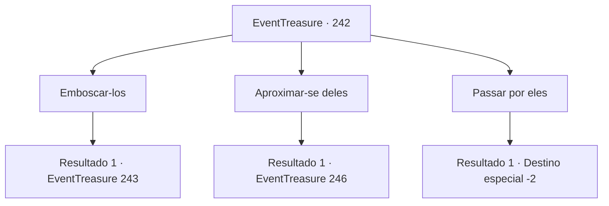

# Eventos de tesouro · 242

[Índice da tabela](index.md) · [Índice geral](../index.md)

ID: `pt:EventTreasure:242` · Fonte: `EventTreasure4` · Versão: 1.2.47.

Mapeamento estático dos arquivos; a disponibilidade e a execução dependem do estado da run.

## Texto do evento

Você avista um grupo de aventureiros e para. Eles parecem estar saindo de uma masmorra parecida com uma caverna, e tem sangue em suas armaduras parecendo estar machucados. Parece que o grupo de aventureiros está indo para uma vila próxima. Você pega a mochila deles cheia de barras de ouro como se isso estivesse tentando você.

## Dados de entrada

```json
{
  "id": 242,
  "grade": 2,
  "place": "",
  "required": "1_2_40|5_539_0|26_10_1"
}
```

## Mapa das escolhas



## Escolhas e resultados

### Escolha 1

Emboscar-los

Requisitos e outros campos da escolha:

```json
{
  "required": "2_3_-24"
}
```

#### Resultado 1.1

Você captura os aventureiros e os ataca surpreendentemente enquanto eles se dirigem à vila. 

 "Argh! É um inimigo! Aqueles que puderem lutar, peguem suas armas!"

 Os aventureiros se preparam habilmente para contra-atacar, apesar de seus corpos feridos. Você lança um ataque preventivo antes que eles possam se formar.

Continuação registrada: [Evento 243](0243.md) na mesma tabela.

```json
{
  "required": "",
  "chance": "1",
  "nextEvent": 243,
  "type": 2,
  "reward": "0_3_-3|6_0_62|5_539_1",
  "place": 1
}
```

### Escolha 2

Aproximar-se deles

Requisitos e outros campos da escolha:

```json
{
  "required": ""
}
```

#### Resultado 2.1

Você se aproxima dos aventureiros que estão indo para a vila. Quando você aparece, um homem, que parece ser o líder, grita urgentemente. 

 "Espera! Não se aproxime mais. Se você tem algo a dizer, diga daí mesmo."

 Antes que você perceba, eles têm suas mãos em suas armas e te encaram fixamente.

Continuação registrada: [Evento 246](0246.md) na mesma tabela.

```json
{
  "required": "",
  "chance": "1",
  "nextEvent": 246,
  "type": 2,
  "reward": "5_539_1"
}
```

### Escolha 3

Passar por eles

Requisitos e outros campos da escolha:

```json
{
  "required": ""
}
```

#### Resultado 3.1

Você não se aproxima dos aventureiros e passa silenciosamente ao lado deles.

Continuação registrada: [Destino especial `-2`](../destinos-especiais.md).

```json
{
  "required": "",
  "chance": "1",
  "nextEvent": -2,
  "type": 2,
  "reward": "5_539_9"
}
```

## Referências que chegam a este evento

Nenhum `nextEvent` positivo da mesma tabela aponta para este nó. Isso não prova que seja inacessível: sorteio e estado de história podem selecioná-lo.

