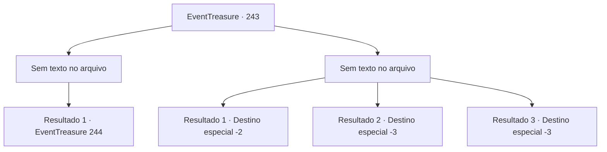

# Eventos de tesouro · 243

[Índice da tabela](index.md) · [Índice geral](../index.md)

ID: `pt:EventTreasure:243` · Fonte: `EventTreasure4` · Versão: 1.2.47.

Mapeamento estático dos arquivos; a disponibilidade e a execução dependem do estado da run.

## Texto do evento

*Sem texto no arquivo.*

## Dados de entrada

```json
{
  "id": 243,
  "grade": 1,
  "place": "",
  "required": ""
}
```

## Mapa das escolhas



## Escolhas e resultados

### Escolha 1

*Sem texto no arquivo; o papel dessa opção depende da interface do jogo.*

Requisitos e outros campos da escolha:

```json
{
  "required": ""
}
```

#### Resultado 1.1

Você está em menor número, mas os aventureiros feridos caem rapidamente. Você levanta sua arma para matá-los. Nesse momento, um homem, que parece ser o líder, ofega e grita. 

 "T-Todos, deixem tudo para trás e corram! Ugh...!! Procurem ajuda..."

 Depois de gritar, o homem cospe sangue e abaixa a cabeça. Os aventureiros restantes abandonam seus aliados e ouro e se dispersam.

Continuação registrada: [Evento 244](0244.md) na mesma tabela.

```json
{
  "required": "",
  "chance": "1",
  "nextEvent": 244,
  "type": 2,
  "reward": ""
}
```

### Escolha 2

*Sem texto no arquivo; o papel dessa opção depende da interface do jogo.*

Requisitos e outros campos da escolha:

```json
{
  "required": ""
}
```

#### Resultado 2.1

Os aventureiros podem estar feridos, mas sua vantagem em números não pode ser ignorada. Depois de ser empurrado instantaneamente para trás, finalmente decides dar a volta e fugir. 

 "Não vá atrás dele! A prioridade é a vila!"

 Os aventureiros não te perseguem e tentam chegar à vila próxima.

Continuação registrada: [Destino especial `-2`](../destinos-especiais.md).

```json
{
  "required": "1_0_2|1_1_2",
  "chance": "1",
  "nextEvent": -2,
  "type": 2,
  "reward": "0_0_-1|0_1_-1|5_539_9"
}
```

#### Resultado 2.2

Os aventureiros podem estar feridos, mas sua vantagem em números não pode ser ignorada. Uma flecha que não conseguiste bloquear atravessa teu coração, e cais enquanto vomitas sangue. O toque frio da morte chega instantaneamente por ti.

Continuação registrada: [Destino especial `-3`](../destinos-especiais.md).

```json
{
  "required": "2_0_2",
  "chance": "1",
  "nextEvent": -3,
  "type": 2,
  "reward": "0_0_-1|0_1_-1"
}
```

#### Resultado 2.3

Os aventureiros podem estar feridos, mas sua vantagem em números não pode ser ignorada. Uma flecha que não conseguiste bloquear atravessa teu coração, e cais enquanto vomitas sangue. O toque frio da morte chega instantaneamente por ti.

Continuação registrada: [Destino especial `-3`](../destinos-especiais.md).

```json
{
  "required": "2_1_2",
  "chance": "1",
  "nextEvent": -3,
  "type": 2,
  "reward": "0_0_-1|0_1_-1"
}
```

## Referências que chegam a este evento

- [Evento 242 · escolha 1 · resultado 1](0242.md#escolha-1)
- [Evento 246 · escolha 1 · resultado 2](0246.md#escolha-1)
- [Evento 246 · escolha 3 · resultado 1](0246.md#escolha-3)
