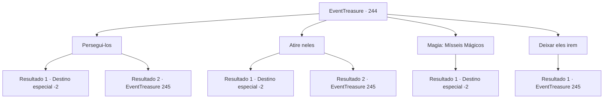

# Eventos de tesouro · 244

[Índice da tabela](index.md) · [Índice geral](../index.md)

ID: `pt:EventTreasure:244` · Fonte: `EventTreasure4` · Versão: 1.2.47.

Mapeamento estático dos arquivos; a disponibilidade e a execução dependem do estado da run.

## Texto do evento

*Sem texto no arquivo.*

## Dados de entrada

```json
{
  "id": 244,
  "grade": 1,
  "place": "",
  "required": ""
}
```

## Mapa das escolhas



## Escolhas e resultados

### Escolha 1

Persegui-los

Requisitos e outros campos da escolha:

```json
{
  "required": ""
}
```

#### Resultado 1.1

Você persegue os aventureiros como se estivesse caçando-os. Eles escapam para uma floresta onde poderiam esconder seus corpos, mas não podem esconder o sangue de suas feridas. Depois de persegui-los com sucesso, você mata impiedosamente os aventureiros capturados. <color=red>

 "Por favor, por favor, não me mate!"

</color> 30 minutos depois, você retorna ao local onde a batalha começou depois de cuidar dos aventureiros. E depois de pegar o ouro de sua bagagem abandonada, você sai tranquilamente.

Continuação registrada: [Destino especial `-2`](../destinos-especiais.md).

```json
{
  "required": "",
  "chance": "1|0_14_1",
  "nextEvent": -2,
  "type": 0,
  "reward": "0_2_1|0_4_150|5_539_9"
}
```

#### Resultado 1.2

Você segue os aventureiros, mas acaba perdendo um. Porque o aventureiro desapareceu completamente de sua vista, eventualmente você desiste de perseguir o aventureiro e volta para o local onde a batalha começou. E você pega o ouro de sua bagagem abandonada e segue seu caminho. 

 Talvez tenha se passado uma hora. Você saca sua arma depois de ouvir o som de apitos vindo de todos os lados. Os soldados armados com lanças, maças e arcos se aproximam de você. 

 "Capture o vilão! O vilão malvado que os aventureiros mencionaram está dentro!"

 Enquanto o homem montado em um cavalo grita, os soldados também gritam com ele.

Continuação registrada: [Evento 245](0245.md) na mesma tabela.

```json
{
  "required": "",
  "chance": "16",
  "nextEvent": 245,
  "type": 1,
  "reward": "0_4_150"
}
```

### Escolha 2

Atire neles

Requisitos e outros campos da escolha:

```json
{
  "required": "20_6_1"
}
```

#### Resultado 2.1

Você atira nos aventureiros que fogem como se estivesse caçando. Eles escapam para se esconder na floresta, mas não conseguem evitar os tiros por trás. Um por um, os aventureiros que fogem começam a cair no chão. <color=red>

 "Por favor, por favor, não me mate!"

</color> 30 minutos depois, você retorna ao local onde a batalha começou depois de lidar com os aventureiros. E depois de pegar o ouro de sua bagagem abandonada, você sai tranquilamente.

Continuação registrada: [Destino especial `-2`](../destinos-especiais.md).

```json
{
  "required": "",
  "chance": "1|0_6_1",
  "nextEvent": -2,
  "type": 0,
  "reward": "0_2_1|0_4_150|5_539_9"
}
```

#### Resultado 2.2

Você matou os aventureiros que estavam fugindo, mas acaba perdendo um. Como o aventureiro desapareceu completamente de sua vista, você eventualmente desiste de persegui-lo e retorna ao local onde a batalha começou. E você pega o ouro de sua bagagem abandonada e segue seu caminho. 

 Talvez tenha se passado uma hora. Você saca sua arma depois de ouvir o som de apitos vindo de todos os lados. Os soldados armados com lanças, maças e arcos se aproximam de você. 

 "Peguem o vilão! O vilão malvado que os aventureiros mencionaram está dentro!"

 Enquanto o homem montado em um cavalo grita, os soldados também gritam com ele.

Continuação registrada: [Evento 245](0245.md) na mesma tabela.

```json
{
  "required": "",
  "chance": "16",
  "nextEvent": 245,
  "type": 1,
  "reward": "0_4_150"
}
```

### Escolha 3

Magia: Mísseis Mágicos

Requisitos e outros campos da escolha:

```json
{
  "required": "20_0_1"
}
```

#### Resultado 3.1

Lanço o Míssil Mágico sobre os aventureiros em fuga como se estivesse caçando-os. Eles escapam para se esconder na floresta, mas não conseguem evitar os fragmentos de magia que voam em sua direção. Um por um, os aventureiros em fuga começam a cair no chão. <color=red>

 "Por favor, por favor, não me mate!"

</color> 30 minutos depois, você retorna ao local onde a batalha começou depois de lidar com os aventureiros. E depois de pegar o ouro de sua bagagem abandonada, você sai tranquilamente.

Continuação registrada: [Destino especial `-2`](../destinos-especiais.md).

```json
{
  "required": "",
  "chance": "1",
  "nextEvent": -2,
  "type": 2,
  "reward": "0_2_1|0_4_150|5_539_9"
}
```

### Escolha 4

Deixar eles irem

Requisitos e outros campos da escolha:

```json
{
  "required": ""
}
```

#### Resultado 4.1

Você deixa os aventureiros fugirem e pega o ouro das bagagens abandonadas. Em seguida, passa por cima do cadáver do líder e vai embora tranquilamente. 

 Talvez tenha se passado uma hora. Você saca sua arma depois de ouvir o som de apitos vindo de todos os lados. Os soldados armados com lanças, maças e arcos se aproximam de você. 

 "Peguem o vilão! O vilão malvado mencionado pelos aventureiros está dentro!"

 Enquanto o homem montado a cavalo grita, os soldados também gritam com ele.

Continuação registrada: [Evento 245](0245.md) na mesma tabela.

```json
{
  "required": "",
  "chance": "1",
  "nextEvent": 245,
  "type": 2,
  "reward": "0_4_150"
}
```

## Referências que chegam a este evento

- [Evento 243 · escolha 1 · resultado 1](0243.md#escolha-1)
