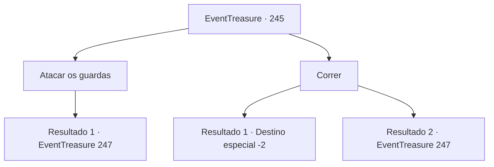

# Eventos de tesouro · 245

[Índice da tabela](index.md) · [Índice geral](../index.md)

ID: `pt:EventTreasure:245` · Fonte: `EventTreasure4` · Versão: 1.2.47.

Mapeamento estático dos arquivos; a disponibilidade e a execução dependem do estado da run.

## Texto do evento

*Sem texto no arquivo.*

## Dados de entrada

```json
{
  "id": 245,
  "grade": 1,
  "place": "",
  "required": ""
}
```

## Mapa das escolhas



## Escolhas e resultados

### Escolha 1

Atacar os guardas

Requisitos e outros campos da escolha:

```json
{
  "required": ""
}
```

#### Resultado 1.1

No te escapas e enfrenta os soldados que se aproximam. Nesse momento, inúmeras armas vêm voando de todos os lados.

Continuação registrada: [Evento 247](0247.md) na mesma tabela.

```json
{
  "required": "",
  "chance": "1",
  "nextEvent": 247,
  "type": 2,
  "reward": "6_3_136",
  "place": 1
}
```

### Escolha 2

Correr

Requisitos e outros campos da escolha:

```json
{
  "required": ""
}
```

#### Resultado 2.1

Você encontra uma abertura em seu perímetro e escapa rapidamente. Os soldados te perseguem por mais de uma hora, mas acabam perdendo você. Depois de escapar por pouco deles, você segue para uma rua vazia.

Continuação registrada: [Destino especial `-2`](../destinos-especiais.md).

```json
{
  "required": "",
  "chance": "1|0_6_1",
  "nextEvent": -2,
  "type": 0,
  "reward": "0_2_1|5_539_9"
}
```

#### Resultado 2.2

Tentas escapar rapidamente, mas o perímetro dos soldados não possui nenhuma abertura. Finalmente, desistes em tua tentativa de fugir e decides enfrentá-los. Nesse momento, inúmeras armas vêm voando de todos os lados.

Continuação registrada: [Evento 247](0247.md) na mesma tabela.

```json
{
  "required": "",
  "chance": "18",
  "nextEvent": 247,
  "type": 1,
  "reward": "6_3_21",
  "place": 1
}
```

## Referências que chegam a este evento

- [Evento 244 · escolha 1 · resultado 2](0244.md#escolha-1)
- [Evento 244 · escolha 2 · resultado 2](0244.md#escolha-2)
- [Evento 244 · escolha 4 · resultado 1](0244.md#escolha-4)
