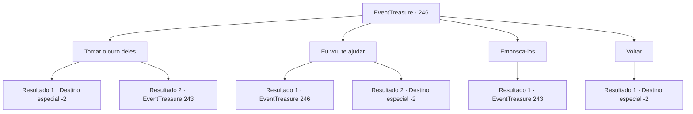

# Eventos de tesouro · 246

[Índice da tabela](index.md) · [Índice geral](../index.md)

ID: `pt:EventTreasure:246` · Fonte: `EventTreasure4` · Versão: 1.2.47.

Mapeamento estático dos arquivos; a disponibilidade e a execução dependem do estado da run.

## Texto do evento

*Sem texto no arquivo.*

## Dados de entrada

```json
{
  "id": 246,
  "grade": 1,
  "place": "",
  "required": ""
}
```

## Mapa das escolhas



## Escolhas e resultados

### Escolha 1

Tomar o ouro deles

Requisitos e outros campos da escolha:

```json
{
  "required": ""
}
```

#### Resultado 1.1

Ameaças aos aventureiros para entregarem seu ouro. Os aventureiros começam a recuar com rostos nervosos diante da ameaça assustadora. Entre eles, um homem que parece ser o líder entrega o ouro como se não tivesse outra opção. 

 "Aqui, todo o ouro que temos. Pegue."

 Os aventureiros entregam o ouro e voltam para a vila. Você verifica o ouro e os observa partirem antes de se afastar.

Continuação registrada: [Destino especial `-2`](../destinos-especiais.md).

```json
{
  "required": "",
  "chance": "1|0_12_1",
  "nextEvent": -2,
  "type": 0,
  "reward": "0_3_-2|0_4_150|5_539_9"
}
```

#### Resultado 1.2

Ameaças aos aventureiros para entregarem seu ouro. No entanto, eles não cedem facilmente diante de sua ameaça. 

 "Ugh! É um inimigo! Aqueles que puderem lutar, peguem suas armas!"

 Os aventureiros se preparam habilmente para contra-atacar com seus corpos feridos. Você lança um ataque preventivo antes que eles possam se formar.

Continuação registrada: [Evento 243](0243.md) na mesma tabela.

```json
{
  "required": "",
  "chance": "16",
  "nextEvent": 243,
  "type": 1,
  "reward": "6_0_62",
  "place": 1
}
```

### Escolha 2

Eu vou te ajudar

Requisitos e outros campos da escolha:

```json
{
  "required": "5_539_0"
}
```

#### Resultado 2.1

Você diz que vai ajudar. O homem, que parece ser o líder, responde com voz baixa. 

 "Nós cuidaremos de nós mesmos. Espero que você simplesmente nos ignore."

 Os outros também agem com muita cautela ao seu redor. Os olhos frios dos aventureiros te atravessam.

Continuação registrada: [Evento 246](0246.md) na mesma tabela.

```json
{
  "required": "2_3_-24",
  "chance": "1",
  "nextEvent": 246,
  "type": 2,
  "reward": "5_539_1"
}
```

#### Resultado 2.2

Você diz que vai ajudar. Eles te observam por um momento antes de baixarem a guarda. Você cuida de seus ferimentos, enrolando bandagens, aplicando talas, ajudando no que pode. 

 "Obrigado pela sua ajuda. Pedimos desculpas por termos sido tão duros."

 O líder, um homem, inclina a cabeça em agradecimento, os outros aventureiros seguem seu exemplo. 

 "Não é muito... mas por favor aceite isso."

 Eles juntam uma pequena quantidade de ouro e te entregam. Depois eles vão embora, apoiando-se mutuamente.

Continuação registrada: [Destino especial `-2`](../destinos-especiais.md).

```json
{
  "required": "1_3_-24",
  "chance": "1",
  "nextEvent": -2,
  "type": 2,
  "reward": "0_3_2|0_4_30|5_539_9"
}
```

### Escolha 3

Embosca-los

Requisitos e outros campos da escolha:

```json
{
  "required": ""
}
```

#### Resultado 3.1

Atacas os aventureiros cautelosos. 

 "Urgh! É um inimigo! Aqueles que puderem lutar, peguem suas armas!"

 Os aventureiros se preparam habilmente para contra-atacar com seus corpos feridos. Lanças um ataque preventivo antes que possam se formar.

Continuação registrada: [Evento 243](0243.md) na mesma tabela.

```json
{
  "required": "",
  "chance": "1",
  "nextEvent": 243,
  "type": 2,
  "reward": "0_3_-2|6_0_62",
  "place": 1
}
```

### Escolha 4

Voltar

Requisitos e outros campos da escolha:

```json
{
  "required": ""
}
```

#### Resultado 4.1

Você se retira voluntariamente como lhe pediram. Os aventureiros sussurram um pouco e se dirigem à vila.

Continuação registrada: [Destino especial `-2`](../destinos-especiais.md).

```json
{
  "required": "",
  "chance": "1",
  "nextEvent": -2,
  "type": 2,
  "reward": "5_539_9"
}
```

## Referências que chegam a este evento

- [Evento 242 · escolha 2 · resultado 1](0242.md#escolha-2)
- [Evento 246 · escolha 2 · resultado 1](0246.md#escolha-2)
