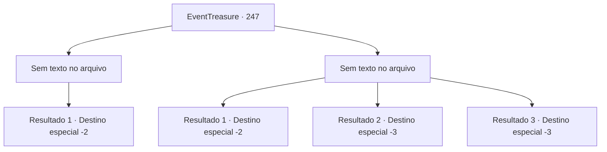

# Eventos de tesouro · 247

[Índice da tabela](index.md) · [Índice geral](../index.md)

ID: `pt:EventTreasure:247` · Fonte: `EventTreasure4` · Versão: 1.2.47.

Mapeamento estático dos arquivos; a disponibilidade e a execução dependem do estado da run.

## Texto do evento

*Sem texto no arquivo.*

## Dados de entrada

```json
{
  "id": 247,
  "grade": 1,
  "place": "",
  "required": ""
}
```

## Mapa das escolhas



## Escolhas e resultados

### Escolha 1

*Sem texto no arquivo; o papel dessa opção depende da interface do jogo.*

Requisitos e outros campos da escolha:

```json
{
  "required": ""
}
```

#### Resultado 1.1


 "Ahhh! É um demônio! Um demônio apareceu!"

 O último soldado em pé foge assustado. Em vez de persegui-lo, você simplesmente sacode o sangue de sua arma. Olhando ao redor, você vê corpos jogados ao seu redor. Você sente um cheiro desconhecido vindo dos corpos em decomposição ou do cheiro que cobre todo o seu corpo. Você passa por cima da pilha de corpos e vai embora.

Continuação registrada: [Destino especial `-2`](../destinos-especiais.md).

```json
{
  "required": "",
  "chance": "1",
  "nextEvent": -2,
  "type": 2,
  "reward": "27_30_1|5_539_9"
}
```

### Escolha 2

*Sem texto no arquivo; o papel dessa opção depende da interface do jogo.*

Requisitos e outros campos da escolha:

```json
{
  "required": ""
}
```

#### Resultado 2.1

À medida que a batalha continua, você vê uma abertura no perímetro apertado dos guardas. Você não perde a oportunidade e escapa rapidamente. Os guardas te perseguem por mais de uma hora, mas acabam perdendo você. Depois de escapar por pouco deles, você segue para uma rua vazia.

Continuação registrada: [Destino especial `-2`](../destinos-especiais.md).

```json
{
  "required": "1_0_2|1_1_2",
  "chance": "1",
  "nextEvent": -2,
  "type": 2,
  "reward": "0_0_-1|0_1_-1|5_539_9"
}
```

#### Resultado 2.2

Os guardas que te cercavam continuaram atacando incansavelmente. Depois de ser esfaqueado com lanças, golpeado com maças e atravessado por flechas, finalmente exalas o teu último suspiro.

Continuação registrada: [Destino especial `-3`](../destinos-especiais.md).

```json
{
  "required": "2_0_2",
  "chance": "1",
  "nextEvent": -3,
  "type": 2,
  "reward": "0_0_-1|0_1_-1"
}
```

#### Resultado 2.3

Os guardas que te cercavam continuaram atacando incansavelmente. Depois de ser esfaqueado com lanças, golpeado com maças e atravessado por flechas, finalmente exalas o teu último suspiro.

Continuação registrada: [Destino especial `-3`](../destinos-especiais.md).

```json
{
  "required": "2_1_2",
  "chance": "1",
  "nextEvent": -3,
  "type": 2,
  "reward": "0_0_-1|0_1_-1"
}
```

## Referências que chegam a este evento

- [Evento 245 · escolha 1 · resultado 1](0245.md#escolha-1)
- [Evento 245 · escolha 2 · resultado 2](0245.md#escolha-2)
