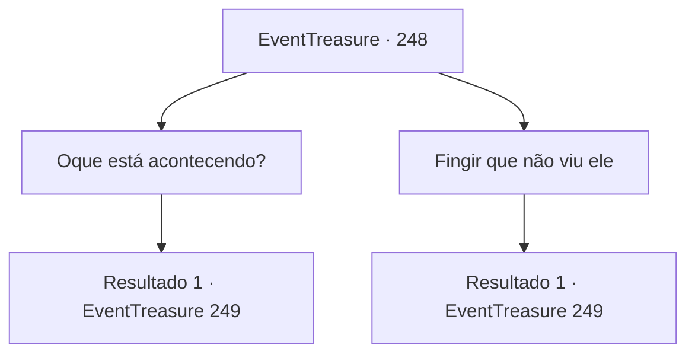

# Eventos de tesouro · 248

[Índice da tabela](index.md) · [Índice geral](../index.md)

ID: `pt:EventTreasure:248` · Fonte: `EventTreasure4` · Versão: 1.2.47.

Mapeamento estático dos arquivos; a disponibilidade e a execução dependem do estado da run.

## Texto do evento

Você chega a um pequeno castelo chamado ‘Valderk’ Também é chamado de ‘Ninho de Prata’ porque existem várias minas de prata nas proximidades. Você anda dentro do castelo e olha para os residentes. 

 "Depressa aqui! Temos que acabar com isso antes que eles cheguem!"

 "Você tem que garantir seu próprio lugar, não importa o que aconteça! Você entende?"

 Por alguma razão, a atmosfera de Valderk parece estranha. Os mercadores e viajantes não foram encontrados em lugar nenhum, e apenas soldados armados estão correndo por aí com urgência.

## Dados de entrada

```json
{
  "id": 248,
  "grade": 2,
  "place": "",
  "required": "1_2_25|5_540_0|26_8_1"
}
```

## Mapa das escolhas



## Escolhas e resultados

### Escolha 1

Oque está acontecendo?

Requisitos e outros campos da escolha:

```json
{
  "required": ""
}
```

#### Resultado 1.1

Você se aproximou do homem e perguntou qual era o problema. Ele observa o seu comportamento e então, suspirando, desabafa sobre a sua situação. 

 "Uf, eu sou 'Henry Astro', o dono deste castelo. Você conhece os três irmãos gigantes?"

 Quando você balança a cabeça negativamente, Henry explica sobre os três irmãos gigantes. Eles são um grupo formado por gigantes da colina, gigantes de gelo e gigantes de fogo, famosos vilões ativos perto das minas de prata. 

 "Há três dias, os três irmãos gigantes vieram a este castelo. Eles me ameaçaram para entregar minha filha como noiva do gigante de fogo, ou eles destruiriam todo o castelo."

 O suor escorre pela testa de Henry enquanto ele relembra o incidente. Enquanto ele seca o suor com um lenço, Henry continua sua história. É claro, eu recusei. Então eles nos atacaram com uma investida assustadora. As paredes do castelo se despedaçaram como papel, e muitos soldados morreram ou ficaram feridos. Segundo Henry, os gigantes impiedosos, após o ataque, deixaram uma mensagem dizendo que voltariam em três dias. Ele suspira profundamente e diz, 

 "Esse dia é hoje. Os gigantes voltarão em breve... Não sei como enfrentá-los."


Continuação registrada: [Evento 249](0249.md) na mesma tabela.

```json
{
  "required": "",
  "chance": "1",
  "nextEvent": 249,
  "type": 2,
  "reward": "5_540_1"
}
```

### Escolha 2

Fingir que não viu ele

Requisitos e outros campos da escolha:

```json
{
  "required": ""
}
```

#### Resultado 2.1

Tentaste fingir que não tinhas visto o homem, mas ele aproximou-se primeiro de ti e pediu ajuda. 

 "... Sou 'Henry Astro', o dono deste castelo. Conheces os três irmãos gigantes?"

 Quando abanas a cabeça, Henry explica sobre os três irmãos gigantes. Eles são um grupo formado por gigantes de colina, gigantes de gelo e gigantes de fogo, famosos vilões ativos perto das minas de prata. 

 "Há três dias, os três irmãos gigantes vieram a este castelo. Ameaçaram-me para entregar a minha filha como noiva ao gigante de fogo, ou destruiriam todo o castelo."

 O suor escorre pela testa de Henry enquanto ele recorda o incidente. Enquanto seca o suor com um lenço, Henry continua a sua história. 

 "Claro que recusei. Então eles atacaram-nos com um ímpeto ameaçador. As paredes do castelo desmoronaram-se como papel, e muitos soldados morreram ou ficaram feridos."

 Segundo Henry, os impiedosos gigantes, após o seu ataque, deixaram uma mensagem dizendo que voltariam em três dias. Suspira profundamente e diz, 

 "Esse dia é hoje. Os gigantes voltarão em breve... Não sei como lidar com eles."


Continuação registrada: [Evento 249](0249.md) na mesma tabela.

```json
{
  "required": "",
  "chance": "1",
  "nextEvent": 249,
  "type": 2,
  "reward": "5_540_1"
}
```

## Referências que chegam a este evento

Nenhum `nextEvent` positivo da mesma tabela aponta para este nó. Isso não prova que seja inacessível: sorteio e estado de história podem selecioná-lo.

