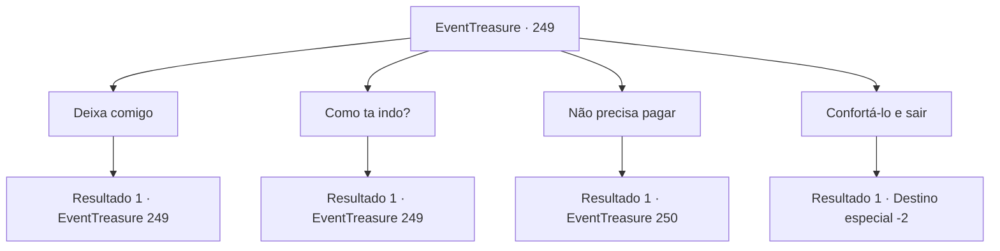

# Eventos de tesouro · 249

[Índice da tabela](index.md) · [Índice geral](../index.md)

ID: `pt:EventTreasure:249` · Fonte: `EventTreasure4` · Versão: 1.2.47.

Mapeamento estático dos arquivos; a disponibilidade e a execução dependem do estado da run.

## Texto do evento

*Sem texto no arquivo.*

## Dados de entrada

```json
{
  "id": 249,
  "grade": 1,
  "place": "",
  "required": ""
}
```

## Mapa das escolhas



## Escolhas e resultados

### Escolha 1

Deixa comigo

Requisitos e outros campos da escolha:

```json
{
  "required": "5_541_0"
}
```

#### Resultado 1.1

Você aceita de bom grado cuidar de sua preocupação, mas Henry ainda parece desanimado mesmo depois de ouvir sua resposta. Cautelosamente, ele faz uma pergunta. 

 "...Não acho que possa oferecer a você nenhuma recompensa além de álcool ou comida, está bem? Os dias não têm sido gentis conosco ultimamente."


Continuação registrada: [Evento 249](0249.md) na mesma tabela.

```json
{
  "required": "",
  "chance": "1",
  "nextEvent": 249,
  "type": 2,
  "reward": "5_541_1"
}
```

### Escolha 2

Como ta indo?

Requisitos e outros campos da escolha:

```json
{
  "required": "5_578_0"
}
```

#### Resultado 2.1

Você pergunta a Henry sobre a situação atual. Ele solta um suspiro ainda mais profundo e diz, 

 "Mais da metade dos nossos soldados estão mortos ou feridos. Além disso, os que restam estão com muito medo de lutar contra os gigantes. Se continuarmos assim..."

 Ele deixa a frase sem terminar. Olhando para os soldados feridos ao seu redor, Henry se vira para você e diz, 

 "Talvez você esteja pensando, por que não simplesmente entregar minha filha a eles, mas não é um problema que possa ser resolvido tão facilmente. Eles continuarão exigindo mais, não apenas minha filha. Eventualmente, eles levarão tudo neste castelo."


Continuação registrada: [Evento 249](0249.md) na mesma tabela.

```json
{
  "required": "",
  "chance": "1",
  "nextEvent": 249,
  "type": 2,
  "reward": "5_578_1"
}
```

### Escolha 3

Não precisa pagar

Requisitos e outros campos da escolha:

```json
{
  "required": "5_541_1"
}
```

#### Resultado 3.1

Em resposta às tuas palavras, Henry segurou tua mão e abaixou repetidamente a cabeça em gratidão. Tu cuidaste das tuas armas, esperando a aparição dos Irmãos Gigantes. 

 Um estrondo sacode o chão e tu sais pela porta do castelo. Assim que sais, a porta do castelo se fecha firmemente atrás de ti. E três gigantes se aproximam do castelo. Os soldados que já experimentaram seu poder soltam gritos. Pouco depois, o gigante de fogo que se aproximou olha para a parede do castelo e fala. 

 "Saudações, sogro. Suponho que minha namorada esteja pronta? Hahaha!"

 Diante da risada sincera do gigante de fogo, os outros dois gigantes também começam a rir. Então, ao te notar, ele pergunta a Henry: 'O que é essa coisinha?'

Continuação registrada: [Evento 250](0250.md) na mesma tabela.

```json
{
  "required": "",
  "chance": "1",
  "nextEvent": 250,
  "type": 2,
  "reward": "0_3_1"
}
```

### Escolha 4

Confortá-lo e sair

Requisitos e outros campos da escolha:

```json
{
  "required": ""
}
```

#### Resultado 4.1

Você consola Henry e deixa o castelo de Valderk. Você ouve Henry suspirar profundamente atrás de você.

Continuação registrada: [Destino especial `-2`](../destinos-especiais.md).

```json
{
  "required": "",
  "chance": "1",
  "nextEvent": -2,
  "type": 2,
  "reward": "5_540_9"
}
```

## Referências que chegam a este evento

- [Evento 248 · escolha 1 · resultado 1](0248.md#escolha-1)
- [Evento 248 · escolha 2 · resultado 1](0248.md#escolha-2)
- [Evento 249 · escolha 1 · resultado 1](0249.md#escolha-1)
- [Evento 249 · escolha 2 · resultado 1](0249.md#escolha-2)
