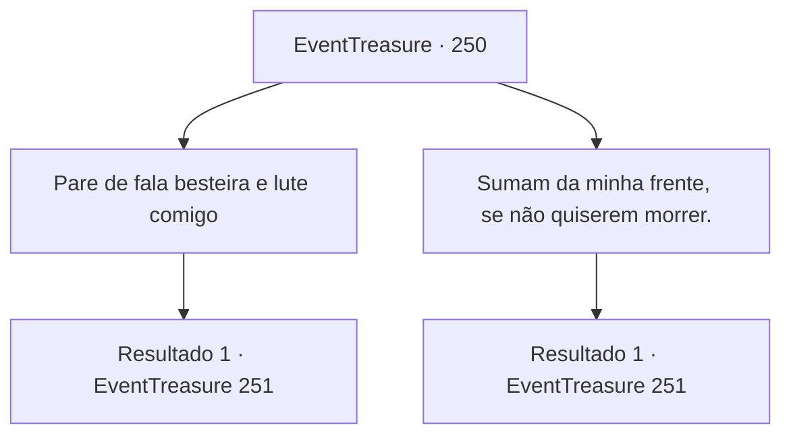

# Eventos de tesouro · 250

[Índice da tabela](index.md) · [Índice geral](../index.md)

ID: `pt:EventTreasure:250` · Fonte: `EventTreasure4` · Versão: 1.2.47.

Mapeamento estático dos arquivos; a disponibilidade e a execução dependem do estado da run.

## Texto do evento

*Sem texto no arquivo.*

## Dados de entrada

```json
{
  "id": 250,
  "grade": 1,
  "place": "",
  "required": ""
}
```

## Mapa das escolhas



## Escolhas e resultados

### Escolha 1

Pare de fala besteira e lute comigo

Requisitos e outros campos da escolha:

```json
{
  "required": ""
}
```

#### Resultado 1.1

Você diz ao gigante para parar de falar bobagens e o desafia. O gigante de fogo olha para você com desagrado e vira a cabeça para Henry. 

 "Olhe aqui. 'Sogro'. Essa é a sua resposta?"

 Com sua pergunta, Henry grita que sim enquanto treme. Os lábios do gigante de fogo tremem de raiva enquanto dá um passo para trás. Então ele cruza os braços e diz ao gigante da colina. 

 "Eu estava tentando ser gentil, mas acho que não vai funcionar. Ei. Castigue-os."

 Assim que o gigante de fogo ordena, o gigante da colina começa a avançar com um grito. O porrete gigante em sua mão balança em sua direção.

Continuação registrada: [Evento 251](0251.md) na mesma tabela.

```json
{
  "required": "",
  "chance": "1",
  "nextEvent": 251,
  "type": 2,
  "reward": "6_0_132",
  "place": 0
}
```

### Escolha 2

Sumam da minha frente, se não quiserem morrer.

Requisitos e outros campos da escolha:

```json
{
  "required": ""
}
```

#### Resultado 2.1

Grita para os três irmãos gigantes irem embora. O gigante de fogo olha para você com desagrado e vira a cabeça para Henry. 

 "Olhe aqui. Genro. Essa é a sua resposta?"

 Com sua pergunta, Henry grita que sim enquanto treme. Os lábios do gigante de fogo tremem de raiva enquanto dá um passo para trás. Então ele cruza os braços e diz para o gigante da colina. 

 "Tentei ser amigável, mas acho que não vai funcionar. Ei. Castigue-os."

 Assim que o gigante de fogo ordena, o gigante da colina começa a avançar com um grito. O gigante com o clube na mão balança em sua direção.

Continuação registrada: [Evento 251](0251.md) na mesma tabela.

```json
{
  "required": "",
  "chance": "1",
  "nextEvent": 251,
  "type": 2,
  "reward": "6_0_132",
  "place": 0
}
```

## Referências que chegam a este evento

- [Evento 249 · escolha 3 · resultado 1](0249.md#escolha-3)
