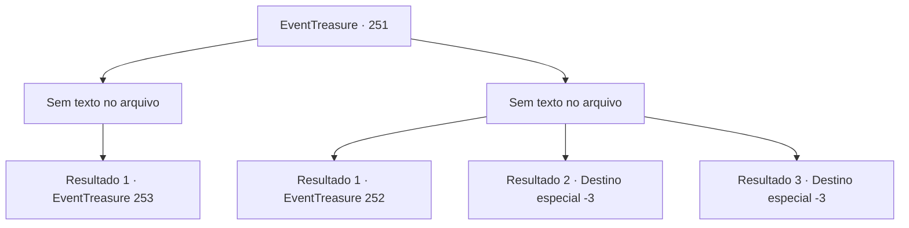

# Eventos de tesouro · 251

[Índice da tabela](index.md) · [Índice geral](../index.md)

ID: `pt:EventTreasure:251` · Fonte: `EventTreasure4` · Versão: 1.2.47.

Mapeamento estático dos arquivos; a disponibilidade e a execução dependem do estado da run.

## Texto do evento

*Sem texto no arquivo.*

## Dados de entrada

```json
{
  "id": 251,
  "grade": 1,
  "place": "",
  "required": ""
}
```

## Mapa das escolhas



## Escolhas e resultados

### Escolha 1

*Sem texto no arquivo; o papel dessa opção depende da interface do jogo.*

Requisitos e outros campos da escolha:

```json
{
  "required": ""
}
```

#### Resultado 1.1

O gigante da colina cai com um barulho alto. Você sobe na cabeça do gigante da colina e encara fixamente o gigante de fogo. O gigante de fogo encolhe e grita. 

 "Hum! Nosso irmão mais novo é o mais fraco entre nós! Vá atrás dele, irmão! Vá e mostre o poder dos gigantes!"

 Com esse comando, o gigante de gelo se lança sobre você com um machado gigante. O gigante de gelo se move como um guerreiro bem treinado.

Continuação registrada: [Evento 253](0253.md) na mesma tabela.

```json
{
  "required": "",
  "chance": "1",
  "nextEvent": 253,
  "type": 2,
  "reward": "6_0_42",
  "place": 0
}
```

### Escolha 2

*Sem texto no arquivo; o papel dessa opção depende da interface do jogo.*

Requisitos e outros campos da escolha:

```json
{
  "required": ""
}
```

#### Resultado 2.1

O golpe do garrote do gigante da colina te atingiu com força. Mas você não se curvou diante de seu ataque e continuou lutando. No final, o gigante da colina se cansou e caiu para trás. 

 "Ofegante... ofegante... não consigo... continuar..."

 Enquanto o gigante da colina se retirava, o gigante de fogo se contorce e grita. 

 "Hmph! Nosso irmão mais novo é o mais fraco entre nós! Vá atrás dele, irmão! Vá e mostre a ele o poder dos gigantes!"

 Com seu grito, o gigante de gelo se aproxima de você com um machado massivo em sua mão.

Continuação registrada: [Evento 252](0252.md) na mesma tabela.

```json
{
  "required": "1_0_2|1_1_2",
  "chance": "1",
  "nextEvent": 252,
  "type": 2,
  "reward": "0_0_-1|0_1_-1"
}
```

#### Resultado 2.2

Depois de você cair, o gigante da colina te levanta pelo pé. E te joga para fora do castelo como lixo. Você aterrissa de cabeça no chão, morrendo.

Continuação registrada: [Destino especial `-3`](../destinos-especiais.md).

```json
{
  "required": "2_0_2",
  "chance": "1",
  "nextEvent": -3,
  "type": 2,
  "reward": "0_0_-1|0_1_-1"
}
```

#### Resultado 2.3

Depois de você cair, o gigante da colina te levanta pelo pé. E te joga para fora do castelo como lixo. Você aterrissa de cabeça no chão, morrendo.

Continuação registrada: [Destino especial `-3`](../destinos-especiais.md).

```json
{
  "required": "2_1_2",
  "chance": "1",
  "nextEvent": -3,
  "type": 2,
  "reward": "0_0_-1|0_1_-1"
}
```

## Referências que chegam a este evento

- [Evento 250 · escolha 1 · resultado 1](0250.md#escolha-1)
- [Evento 250 · escolha 2 · resultado 1](0250.md#escolha-2)
