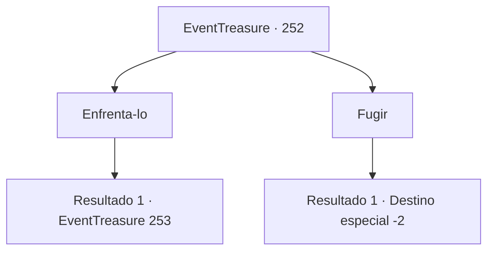

# Eventos de tesouro · 252

[Índice da tabela](index.md) · [Índice geral](../index.md)

ID: `pt:EventTreasure:252` · Fonte: `EventTreasure4` · Versão: 1.2.47.

Mapeamento estático dos arquivos; a disponibilidade e a execução dependem do estado da run.

## Texto do evento

*Sem texto no arquivo.*

## Dados de entrada

```json
{
  "id": 252,
  "grade": 1,
  "place": "",
  "required": ""
}
```

## Mapa das escolhas



## Escolhas e resultados

### Escolha 1

Enfrenta-lo

Requisitos e outros campos da escolha:

```json
{
  "required": ""
}
```

#### Resultado 1.1

Você enfrenta o ataque do gigante de gelo. As pessoas no muro da cidade observam esse espetáculo com expressões tensas.

Continuação registrada: [Evento 253](0253.md) na mesma tabela.

```json
{
  "required": "",
  "chance": "1",
  "nextEvent": 253,
  "type": 2,
  "reward": "6_0_42",
  "place": 0
}
```

### Escolha 2

Fugir

Requisitos e outros campos da escolha:

```json
{
  "required": ""
}
```

#### Resultado 2.1

Você evita o gigante de gelo e foge. O gigante ri da sua figura, e as pessoas no muro da cidade suspiram ou zombam, mas você não para seus passos.

Continuação registrada: [Destino especial `-2`](../destinos-especiais.md).

```json
{
  "required": "",
  "chance": "1",
  "nextEvent": -2,
  "type": 2,
  "reward": "5_540_9"
}
```

## Referências que chegam a este evento

- [Evento 251 · escolha 2 · resultado 1](0251.md#escolha-2)
