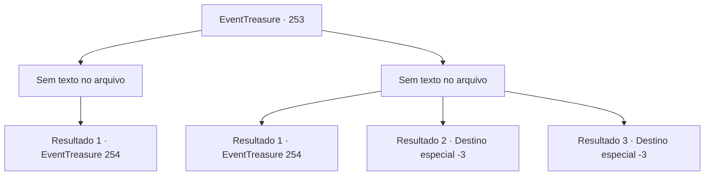

# Eventos de tesouro · 253

[Índice da tabela](index.md) · [Índice geral](../index.md)

ID: `pt:EventTreasure:253` · Fonte: `EventTreasure4` · Versão: 1.2.47.

Mapeamento estático dos arquivos; a disponibilidade e a execução dependem do estado da run.

## Texto do evento

*Sem texto no arquivo.*

## Dados de entrada

```json
{
  "id": 253,
  "grade": 1,
  "place": "",
  "required": ""
}
```

## Mapa das escolhas



## Escolhas e resultados

### Escolha 1

*Sem texto no arquivo; o papel dessa opção depende da interface do jogo.*

Requisitos e outros campos da escolha:

```json
{
  "required": ""
}
```

#### Resultado 1.1

O cadáver frio do gigante de gelo cai diante do gigante de fogo. Depois de olhar para o rosto do gigante de gelo, ele pega sua espada e solta um grito. 

 "Um simples humano matou meu irmão...?! A você! Eu vou te triturar e te beber!"

 Logo, o gigante de fogo se lança em sua direção com sua espada. Sua força é sentida como um vulcão ativo em erupção. O gigante de fogo, enfurecido, grita para você. Nesse momento, as portas do castelo se abrem e Henry e seus homens saem correndo. Uma faísca de esperança arde em seus olhos. 

 "Como podemos depender apenas da boa vontade de um estranho que corajosamente se levanta por nós, quando é o nosso próprio território que devemos proteger?"

 Diante do grito de Henry, os soldados também respondem com vivas. Eles se lançam diretamente contra o gigante de fogo e a luta começa.

Continuação registrada: [Evento 254](0254.md) na mesma tabela.

```json
{
  "required": "",
  "chance": "1",
  "nextEvent": 254,
  "type": 2,
  "reward": "5_579_1"
}
```

### Escolha 2

*Sem texto no arquivo; o papel dessa opção depende da interface do jogo.*

Requisitos e outros campos da escolha:

```json
{
  "required": ""
}
```

#### Resultado 2.1

Depois de horas de luta implacável, o machado do gigante de gelo finalmente quebrou. Apesar da batalha exaustiva, você conseguiu segurar a porta, e o gigante de gelo também, exausto, desmoronou. No entanto, você não está ileso. Seu corpo está encharcado de sangue e suor, balançando como se pudesse desmoronar a qualquer momento. 

 "Como você se atreve...! Miserável! Eu vou te triturar e te beber!"

 O gigante de fogo, enfurecido, grita para você. Nesse momento, as portas do castelo se abrem e Henry e seus homens saem correndo. Uma faísca de esperança arde em seus olhos. 

 "Como podemos depender apenas da boa vontade de um estranho que corajosamente se levanta por nós, quando é o nosso próprio território que devemos proteger!"

 Diante do grito de Henry, os soldados também respondem com vivas. Eles se lançam diretamente contra o gigante de fogo e a luta começa.

Continuação registrada: [Evento 254](0254.md) na mesma tabela.

```json
{
  "required": "1_0_2|1_1_2",
  "chance": "1",
  "nextEvent": 254,
  "type": 2,
  "reward": "0_0_-1|0_1_-1"
}
```

#### Resultado 2.2

A gigantesca machado do gigante de gelo cai sobre você. Incapaz de evitar o ataque, você é partido ao meio e morre.

Continuação registrada: [Destino especial `-3`](../destinos-especiais.md).

```json
{
  "required": "2_0_2",
  "chance": "1",
  "nextEvent": -3,
  "type": 2,
  "reward": "0_0_-1|0_1_-1"
}
```

#### Resultado 2.3

A gigantesca machado do gigante de gelo cai sobre você. Incapaz de evitar o ataque, você é partido ao meio e morre.

Continuação registrada: [Destino especial `-3`](../destinos-especiais.md).

```json
{
  "required": "2_1_2",
  "chance": "1",
  "nextEvent": -3,
  "type": 2,
  "reward": "0_0_-1|0_1_-1"
}
```

## Referências que chegam a este evento

- [Evento 251 · escolha 1 · resultado 1](0251.md#escolha-1)
- [Evento 252 · escolha 1 · resultado 1](0252.md#escolha-1)
