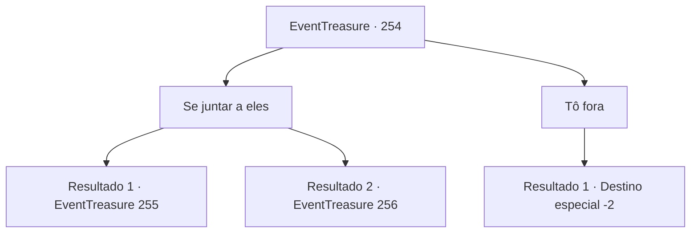

# Eventos de tesouro · 254

[Índice da tabela](index.md) · [Índice geral](../index.md)

ID: `pt:EventTreasure:254` · Fonte: `EventTreasure4` · Versão: 1.2.47.

Mapeamento estático dos arquivos; a disponibilidade e a execução dependem do estado da run.

## Texto do evento

*Sem texto no arquivo.*

## Dados de entrada

```json
{
  "id": 254,
  "grade": 1,
  "place": "",
  "required": ""
}
```

## Mapa das escolhas



## Escolhas e resultados

### Escolha 1

Se juntar a eles

Requisitos e outros campos da escolha:

```json
{
  "required": ""
}
```

#### Resultado 1.1

Você os encontra, enfrentando o último gigante de fogo.

Continuação registrada: [Evento 255](0255.md) na mesma tabela.

```json
{
  "required": "5_579_1",
  "chance": "1",
  "nextEvent": 255,
  "type": 2,
  "reward": "6_2_16",
  "place": 0
}
```

#### Resultado 1.2

Você se junta a eles para atacar os gigantes exaustos.

Continuação registrada: [Evento 256](0256.md) na mesma tabela.

```json
{
  "required": "18_579_1",
  "chance": "1",
  "nextEvent": 256,
  "type": 2,
  "reward": "6_2_16",
  "place": 0
}
```

### Escolha 2

Tô fora

Requisitos e outros campos da escolha:

```json
{
  "required": ""
}
```

#### Resultado 2.1

Você declara que vai se retirar desta batalha agora. Henry dá tapinhas em seu ombro, dizendo, 

 "Você realmente passou por muito. Nós cuidaremos daqui em diante. Obrigado."

 Terminando suas palavras, ele lidera seus soldados para atacar os gigantes, e você se retira do local, deixando-os para trás.

Continuação registrada: [Destino especial `-2`](../destinos-especiais.md).

```json
{
  "required": "",
  "chance": "1",
  "nextEvent": -2,
  "type": 2,
  "reward": "5_540_9"
}
```

## Referências que chegam a este evento

- [Evento 253 · escolha 1 · resultado 1](0253.md#escolha-1)
- [Evento 253 · escolha 2 · resultado 1](0253.md#escolha-2)
