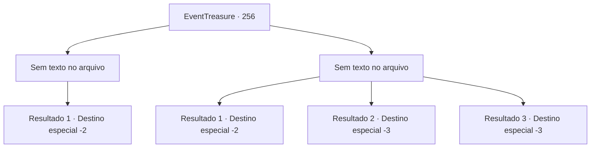

# Eventos de tesouro · 256

[Índice da tabela](index.md) · [Índice geral](../index.md)

ID: `pt:EventTreasure:256` · Fonte: `EventTreasure4` · Versão: 1.2.47.

Mapeamento estático dos arquivos; a disponibilidade e a execução dependem do estado da run.

## Texto do evento

*Sem texto no arquivo.*

## Dados de entrada

```json
{
  "id": 256,
  "grade": 1,
  "place": "",
  "required": ""
}
```

## Mapa das escolhas



## Escolhas e resultados

### Escolha 1

*Sem texto no arquivo; o papel dessa opção depende da interface do jogo.*

Requisitos e outros campos da escolha:

```json
{
  "required": ""
}
```

#### Resultado 1.1


 "Grr... ugh... ser derrotado por... tais criaturas..."

 Sob os persistentes ataques dos soldados e você, o gigante de fogo finalmente caiu. Com isso, todos os gigantes que haviam ameaçado Valderk já não existiam, e Henry e seus soldados se abraçaram, compartilhando sua alegria. <link=shake>

 "Wooooooo!! {1}! {1}! {1}!"

</link> Um festival está sendo celebrado em Valderk para comemorar a morte dos Três Irmãos Gigantes. Henry está destacando suas contribuições diante do povo. 

 "Graças a {1}, conseguimos derrotar os gigantes. Uma determinação tão tremenda que poderia ser chamada de um guerreiro indomável."

 Você está desfrutando da vitória bebendo a gratidão e a deliciosa bebida oferecida pelos cidadãos do castelo.

Continuação registrada: [Destino especial `-2`](../destinos-especiais.md).

```json
{
  "required": "",
  "chance": "1",
  "nextEvent": -2,
  "type": 2,
  "reward": "0_0_1|0_1_1|27_28_1|5_540_9|0_2_1"
}
```

### Escolha 2

*Sem texto no arquivo; o papel dessa opção depende da interface do jogo.*

Requisitos e outros campos da escolha:

```json
{
  "required": ""
}
```

#### Resultado 2.1

Lançado vários metros pelo chute do gigante de fogo, você se chocou contra o chão e perdeu a consciência. 

 Depois de um tempo desconhecido, quando você abre os olhos, contempla a visão de Valderk transformada em ruínas. Os três gigantes destruíram impiedosamente o local e aparentemente desapareceram em algum lugar depois de reduzir a cidade a cinzas. Com o corpo dolorido, você se levanta e deixa Valderk.

Continuação registrada: [Destino especial `-2`](../destinos-especiais.md).

```json
{
  "required": "1_0_2|1_1_2",
  "chance": "1",
  "nextEvent": -2,
  "type": 2,
  "reward": "0_0_-1|0_1_-1|5_540_9"
}
```

#### Resultado 2.2

Lançado vários metros pelo chute do gigante de fogo, você se chocou contra o chão e perdeu a consciência.

Continuação registrada: [Destino especial `-3`](../destinos-especiais.md).

```json
{
  "required": "2_0_2",
  "chance": "1",
  "nextEvent": -3,
  "type": 2,
  "reward": "0_0_-1|0_1_-1"
}
```

#### Resultado 2.3

Lançado vários metros pelo chute do gigante de fogo, você se chocou contra o chão e perdeu a consciência.

Continuação registrada: [Destino especial `-3`](../destinos-especiais.md).

```json
{
  "required": "2_1_2",
  "chance": "1",
  "nextEvent": -3,
  "type": 2,
  "reward": "0_0_-1|0_1_-1"
}
```

## Referências que chegam a este evento

- [Evento 254 · escolha 1 · resultado 2](0254.md#escolha-1)
