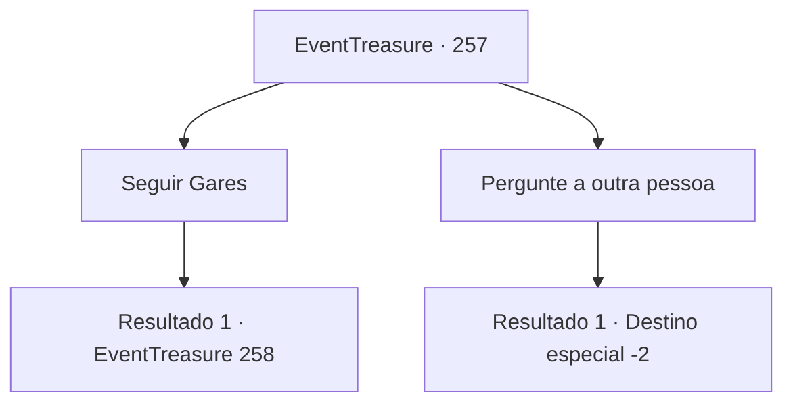

# Eventos de tesouro · 257

[Índice da tabela](index.md) · [Índice geral](../index.md)

ID: `pt:EventTreasure:257` · Fonte: `EventTreasure4` · Versão: 1.2.47.

Mapeamento estático dos arquivos; a disponibilidade e a execução dependem do estado da run.

## Texto do evento

Quando você está prestes a deixar a vila, um cavaleiro vestindo uma armadura vem até você. Ele se apresenta como ‘Gares’ e pede sua ajuda. 

 "Recebi ordens de meu senhor para derrotar o grupo de goblins que residem na ‘Floresta Pailmary’. mas acontece que eles são muito inteligentes."

 De acordo com Gares o grupo de goblins se dispersa quando sua fortaleza é atacada e grupos se reúnem novamente e criam outra fortaleza em outro lugar. E estão causando problemas aos viajantes que passam pela floresta. Ele segura sua mão com força e pede um favor. 

 "Ouvi dizer que você é um aventureiro famoso. Você provavelmente tem mais experiência em lidar com goblins. Creio em você, por favor me ajude."


## Dados de entrada

```json
{
  "id": 257,
  "grade": 2,
  "place": "",
  "required": "1_2_50|5_542_0|26_19_1"
}
```

## Mapa das escolhas



## Escolhas e resultados

### Escolha 1

Seguir Gares

Requisitos e outros campos da escolha:

```json
{
  "required": ""
}
```

#### Resultado 1.1

Você aceita ajudar Gares e segue para a Floresta de Pailmary.  Na entrada da Floresta de Pailmary, há uma loja onde os soldados estão alojados. A maioria dos soldados está ferida, são poucos em número e parecem desanimados. Você entra na maior loja do acampamento com Gares. Gares começa a explicar enquanto abre um mapa.  

 "Eles mudaram sua fortaleza mais uma vez. Mas localizamos alguns lugares que são presumidos como sua nova fortaleza. Esses círculos são as localizações."

  Há quatro localizações, uma perto do rio, uma no centro da floresta, um caminho que leva a uma montanha próxima e uma no topo de um penhasco marcado no mapa.  Após explicar, Gares pede conselhos sobre o que fazer.

Continuação registrada: [Evento 258](0258.md) na mesma tabela.

```json
{
  "required": "",
  "chance": "1",
  "nextEvent": 258,
  "type": 2,
  "reward": "5_542_1"
}
```

### Escolha 2

Pergunte a outra pessoa

Requisitos e outros campos da escolha:

```json
{
  "required": ""
}
```

#### Resultado 2.1

Você se recusa ao pedido dele, dizendo para ele perguntar a outra pessoa. Gares olha para as suas costas com muita decepção, mas não te impede.

Continuação registrada: [Destino especial `-2`](../destinos-especiais.md).

```json
{
  "required": "",
  "chance": "1",
  "nextEvent": -2,
  "type": 2,
  "reward": "5_542_9"
}
```

## Referências que chegam a este evento

Nenhum `nextEvent` positivo da mesma tabela aponta para este nó. Isso não prova que seja inacessível: sorteio e estado de história podem selecioná-lo.

