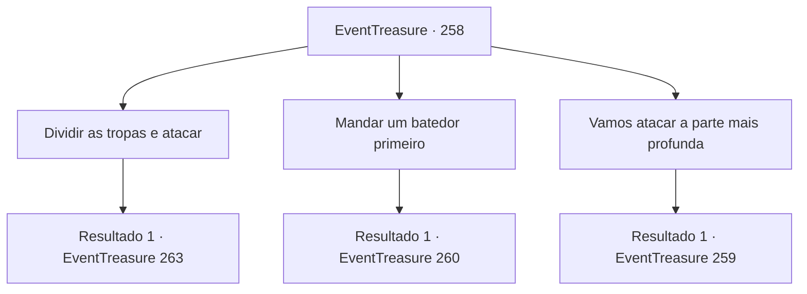

# Eventos de tesouro · 258

[Índice da tabela](index.md) · [Índice geral](../index.md)

ID: `pt:EventTreasure:258` · Fonte: `EventTreasure4` · Versão: 1.2.47.

Mapeamento estático dos arquivos; a disponibilidade e a execução dependem do estado da run.

## Texto do evento

*Sem texto no arquivo.*

## Dados de entrada

```json
{
  "id": 258,
  "grade": 1,
  "place": "",
  "required": ""
}
```

## Mapa das escolhas



## Escolhas e resultados

### Escolha 1

Dividir as tropas e atacar

Requisitos e outros campos da escolha:

```json
{
  "required": ""
}
```

#### Resultado 1.1

Você propõe dividir seu exército e atacar as quatro localizações ao mesmo tempo. 

 "Todas elas? O plano parece um pouco temerário..."

 Embora Gares não esteja certo sobre seu plano, eventualmente ele o aceita e coloca seu exército em formação. Como você não pode ficar para trás para comandar porque teve que dividir o exército, que já era escasso em número, você decide dar uma olhada no topo do penhasco com Gares. Pouco depois de chegar ao penhasco, você olha cuidadosamente ao redor. No entanto, a única coisa que encontra são vestígios de bestas em vez do bastião dos goblins. 

 "Espera! Olha o sinal!"

 Nesse momento, Gares aponta para baixo, abaixo do penhasco, e grita. Uma fumaça vermelha, sinalizando a aniquilação, se eleva. Os outros soldados que estavam indo para as outras localizações devem ter sido eliminados. 

 "Maldição! Segui seu plano porque disseram que você era um aventureiro famoso! O que você vai fazer agora?!"


Continuação registrada: [Evento 263](0263.md) na mesma tabela.

```json
{
  "required": "",
  "chance": "1",
  "nextEvent": 263,
  "type": 2,
  "reward": ""
}
```

### Escolha 2

Mandar um batedor primeiro

Requisitos e outros campos da escolha:

```json
{
  "required": ""
}
```

#### Resultado 2.1

Sugeres enviar primeiro um explorador e localizar a localização exata do bastião. 

 "Hmm. Tens razão. Farei isso imediatamente."

 Gares assente diante do teu plano e forma imediatamente um grupo de exploração. O grupo de exploração formado por soldados veteranos regressa depois de explorar as localizações durante meio dia. De acordo com o seu relatório, o bastião do grupo de goblins parece ser uma caverna gigante perto do rio. 

 "Não podemos simplesmente derrotar o grupo de goblins. Temos que acabar com eles de uma vez por todas. Tens alguma grande ideia?"

 Gares pergunta enquanto acaricia o queixo depois de receber o relatório.

Continuação registrada: [Evento 260](0260.md) na mesma tabela.

```json
{
  "required": "",
  "chance": "1",
  "nextEvent": 260,
  "type": 2,
  "reward": ""
}
```

### Escolha 3

Vamos atacar a parte mais profunda

Requisitos e outros campos da escolha:

```json
{
  "required": ""
}
```

#### Resultado 3.1

Sugeres atacar a localização mais profunda entre as localizações que se supõe serem os bastiões. 

 "A parte mais profunda é... O centro da floresta. Mas não deveríamos explorá-lo primeiro?"

 Gares não está seguro sobre o seu plano, mas eventualmente prepara a marcha de acordo. Logo, você se dirige ao centro da floresta com o exército de Gares. Com tantos feridos, a marcha é lenta e no caminho, ainda mais ficam feridos ao caírem em uma armadilha. Depois de caminhar por cerca de duas horas. Finalmente você chega ao centro da floresta e dá uma olhada ao redor. No entanto, aquele lugar não era o bastião do grupo de goblins. Como se estivessem esperando, Hobgoblins e Bugbears aparecem e emboscam os soldados. 

 "Maldição! É uma emboscada! Todos! Mantenham a calma e contra-ataquem!"

 Ao ouvir o grito de Gares, você rapidamente pega sua arma.

Continuação registrada: [Evento 259](0259.md) na mesma tabela.

```json
{
  "required": "",
  "chance": "1",
  "nextEvent": 259,
  "type": 2,
  "reward": "6_3_22",
  "place": 1
}
```

## Referências que chegam a este evento

- [Evento 257 · escolha 1 · resultado 1](0257.md#escolha-1)
