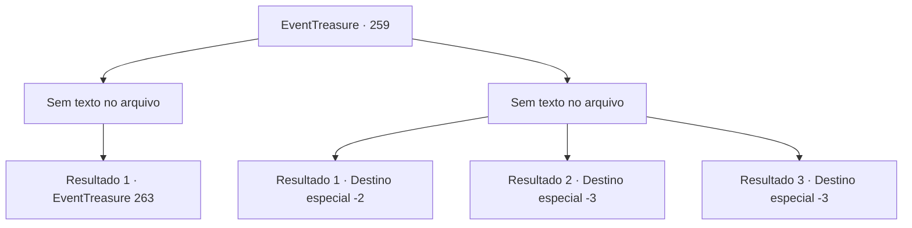

# Eventos de tesouro · 259

[Índice da tabela](index.md) · [Índice geral](../index.md)

ID: `pt:EventTreasure:259` · Fonte: `EventTreasure4` · Versão: 1.2.47.

Mapeamento estático dos arquivos; a disponibilidade e a execução dependem do estado da run.

## Texto do evento

*Sem texto no arquivo.*

## Dados de entrada

```json
{
  "id": 259,
  "grade": 1,
  "place": "",
  "required": ""
}
```

## Mapa das escolhas



## Escolhas e resultados

### Escolha 1

*Sem texto no arquivo; o papel dessa opção depende da interface do jogo.*

Requisitos e outros campos da escolha:

```json
{
  "required": ""
}
```

#### Resultado 1.1

Você é vitorioso na intensa batalha, mas os danos também são graves. Os soldados lutaram até a morte e metade do exército foi destruído. Você e Gares são os únicos que sobreviveram. 

 "Maldição! Segui o seu plano porque disseram que você era um aventureiro famoso! O que você vai fazer agora?!"


Continuação registrada: [Evento 263](0263.md) na mesma tabela.

```json
{
  "required": "",
  "chance": "1",
  "nextEvent": 263,
  "type": 2,
  "reward": ""
}
```

### Escolha 2

*Sem texto no arquivo; o papel dessa opção depende da interface do jogo.*

Requisitos e outros campos da escolha:

```json
{
  "required": ""
}
```

#### Resultado 2.1


 "Retirada! Retirada!"

 Incapaz de continuar lutando, o exército de Gares se retira da emboscada inesperada. Depois de ouvir o grito de Gares, você se escondeu entre os arbustos e evitou ser perseguido/a.

Continuação registrada: [Destino especial `-2`](../destinos-especiais.md).

```json
{
  "required": "1_0_2|1_1_2",
  "chance": "1",
  "nextEvent": -2,
  "type": 2,
  "reward": "0_0_-1|0_1_-1|5_542_9"
}
```

#### Resultado 2.2


 "Retreat! Retreat!"

 Incapaz de continuar lutando, o exército de Gares se retira da emboscada inesperada. Enquanto foge com eles, você é atingido nas costas e cai no chão. No entanto, os soldados assustados te ignoram e continuam fugindo.

Continuação registrada: [Destino especial `-3`](../destinos-especiais.md).

```json
{
  "required": "2_0_2",
  "chance": "1",
  "nextEvent": -3,
  "type": 2,
  "reward": "0_0_-1|0_1_-1"
}
```

#### Resultado 2.3


 "Retreat! Retreat!"

 Incapaz de continuar lutando, o exército de Gares se retira da emboscada inesperada. Enquanto foge com eles, você é atingido nas costas e cai no chão. No entanto, os soldados assustados te ignoram e continuam fugindo.

Continuação registrada: [Destino especial `-3`](../destinos-especiais.md).

```json
{
  "required": "2_1_2",
  "chance": "1",
  "nextEvent": -3,
  "type": 2,
  "reward": "0_0_-1|0_1_-1"
}
```

## Referências que chegam a este evento

- [Evento 258 · escolha 3 · resultado 1](0258.md#escolha-3)
