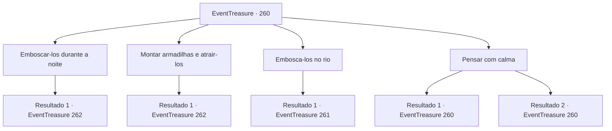

# Eventos de tesouro · 260

[Índice da tabela](index.md) · [Índice geral](../index.md)

ID: `pt:EventTreasure:260` · Fonte: `EventTreasure4` · Versão: 1.2.47.

Mapeamento estático dos arquivos; a disponibilidade e a execução dependem do estado da run.

## Texto do evento

*Sem texto no arquivo.*

## Dados de entrada

```json
{
  "id": 260,
  "grade": 1,
  "place": "",
  "required": ""
}
```

## Mapa das escolhas



## Escolhas e resultados

### Escolha 1

Emboscar-los durante a noite

Requisitos e outros campos da escolha:

```json
{
  "required": ""
}
```

#### Resultado 1.1

Você propõe emboscar a fortaleza durante a noite. Gares concorda e prepara os soldados para a emboscada. Naquela noite, você e o exército de Gares emboscam a fortaleza do grupo de goblins. No entanto, os goblins se defendem habilmente contra a emboscada, mesmo durante a noite. Acontece que os goblins têm olhos que lhes permitem ver no escuro. 

 "Kekeke! Mate todos eles! Hahaha!"

 "Não recuem! Vamos acabar de uma vez por todas com esses goblins malvados aqui!"

 A fortaleza dos goblins se torna instantaneamente caótica. Nesse momento, você vê um xamã goblin lançando feitiços de trás.

Continuação registrada: [Evento 262](0262.md) na mesma tabela.

```json
{
  "required": "",
  "chance": "1",
  "nextEvent": 262,
  "type": 2,
  "reward": "6_3_23",
  "place": 1
}
```

### Escolha 2

Montar armadilhas e atrair-los

Requisitos e outros campos da escolha:

```json
{
  "required": ""
}
```

#### Resultado 2.1

Você propõe colocar armadilhas e atrair os goblins. Gares concorda e ordena aos soldados que coloquem as armadilhas. Na manhã seguinte, você se esconde perto da área onde as armadilhas foram colocadas com o exército de Gares. E a tropa destacada se prepara para a batalha enquanto espera os goblins serem atraídos. 

 "¡Kyahh!"

 "Agora! Todos! Ataquem!"

 Passaram cerca de 30 minutos. Os goblins que perseguem a tropa destacada lutam e caem na armadilha. Nesse momento, Gares grita com sua espada erguida, e os soldados ocultos começam a atacar. Apenas alguns goblins estão presos, mas estão resistindo ferozmente. Nesse momento, você vê um xamã goblin lançando feitiços de trás.

Continuação registrada: [Evento 262](0262.md) na mesma tabela.

```json
{
  "required": "",
  "chance": "1",
  "nextEvent": 262,
  "type": 2,
  "reward": "6_3_23",
  "place": 1
}
```

### Escolha 3

Embosca-los no rio

Requisitos e outros campos da escolha:

```json
{
  "required": "5_580_1"
}
```

#### Resultado 3.1

Você propõe estabelecer uma emboscada no rio perto da fortaleza. Gares concorda e ordena que alguns soldados se preparem para a emboscada. Na manhã seguinte, eles emboscam a fortaleza dos goblins com o exército de Gares. Os goblins defendem habilmente o ataque, como têm feito muitas vezes antes. 

 "¡Kekeke! ¡Matem todos eles! ¡Jajaja!"

 "¡Não recuem! Vamos acabar de uma vez por todas com esses goblins malvados aqui!"

 A fortaleza dos goblins se torna instantaneamente caótica. Nesse momento, você vê um xamã goblin lançando feitiços de trás.

Continuação registrada: [Evento 261](0261.md) na mesma tabela.

```json
{
  "required": "",
  "chance": "1",
  "nextEvent": 261,
  "type": 2,
  "reward": "6_0_23",
  "place": 1
}
```

### Escolha 4

Pensar com calma

Requisitos e outros campos da escolha:

```json
{
  "required": "5_580_0"
}
```

#### Resultado 4.1

Você pensa em um plano para enfrentar os duendes. O problema é que vencer a batalha não faz sentido se os duendes fugirem. Você decide que deve preparar uma emboscada em sua rota de retirada para evitar que escapem. E o rio será uma rota de retirada perfeita, pois eles não poderão fugir tão facilmente. Depois de pensar nas coisas, você sugere sua estratégia a Gares.

Continuação registrada: [Evento 260](0260.md) na mesma tabela.

```json
{
  "required": "",
  "chance": "1|0_7_1",
  "nextEvent": 260,
  "type": 0,
  "reward": "5_580_1"
}
```

#### Resultado 4.2

Você pensa em um plano para enfrentar os duendes. No entanto, você não consegue conceber um bom plano, não importa o quanto pense.

Continuação registrada: [Evento 260](0260.md) na mesma tabela.

```json
{
  "required": "",
  "chance": "16",
  "nextEvent": 260,
  "type": 1,
  "reward": "5_580_2"
}
```

## Referências que chegam a este evento

- [Evento 258 · escolha 2 · resultado 1](0258.md#escolha-2)
- [Evento 260 · escolha 4 · resultado 1](0260.md#escolha-4)
- [Evento 260 · escolha 4 · resultado 2](0260.md#escolha-4)
