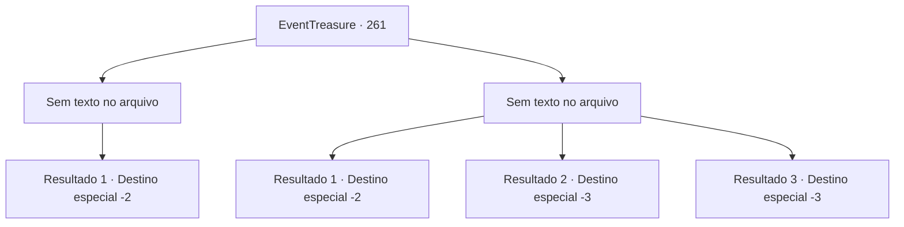

# Eventos de tesouro · 261

[Índice da tabela](index.md) · [Índice geral](../index.md)

ID: `pt:EventTreasure:261` · Fonte: `EventTreasure4` · Versão: 1.2.47.

Mapeamento estático dos arquivos; a disponibilidade e a execução dependem do estado da run.

## Texto do evento

*Sem texto no arquivo.*

## Dados de entrada

```json
{
  "id": 261,
  "grade": 1,
  "place": "",
  "required": ""
}
```

## Mapa das escolhas



## Escolhas e resultados

### Escolha 1

*Sem texto no arquivo; o papel dessa opção depende da interface do jogo.*

Requisitos e outros campos da escolha:

```json
{
  "required": ""
}
```

#### Resultado 1.1

Depois de vencer a batalha, o exército de Gares empurra os duendes de volta para o rio. 

 "Wahhhh!!"

 É claro que mais soldados estão esperando para emboscá-los perto do rio. Os duendes, que estão cercados no meio do rio, lutam, mas são aniquilados sem poder escapar. Com o sucesso do plano, os soldados levantam os punhos e gritam em voz alta. 

 "Embora digam que você era um aventureiro famoso, nunca esperei que fosse tão destacado na arte da estratégia. Você é incrível. Agora que vejo, você não é um aventureiro, mas um 'estrategista'!"

 Gares te parabeniza pela vitória e te dá ouro como recompensa. Depois de receber a recompensa, você deixa a Floresta de Pailmary com as saudações do exército de Gares.

Continuação registrada: [Destino especial `-2`](../destinos-especiais.md).

```json
{
  "required": "",
  "chance": "1",
  "nextEvent": -2,
  "type": 2,
  "reward": "27_43_1|0_4_100|5_542_9"
}
```

### Escolha 2

*Sem texto no arquivo; o papel dessa opção depende da interface do jogo.*

Requisitos e outros campos da escolha:

```json
{
  "required": ""
}
```

#### Resultado 2.1


 "Retreat! Retreat!"

 With the unexpected counterattack, Gares' army retreats without even offering resistance. After hearing Gares' cry, you hide among the bushes to avoid the attack of the goblin shaman.

Continuação registrada: [Destino especial `-2`](../destinos-especiais.md).

```json
{
  "required": "1_0_2|1_1_2",
  "chance": "1",
  "nextEvent": -2,
  "type": 2,
  "reward": "0_0_-1|0_1_-1|5_542_9"
}
```

#### Resultado 2.2

Após a sua derrota, o xamã duende te tortura cruelmente com feitiços. Depois de se entediar, o xamã torce o seu pescoço e procura outro bode expiatório.

Continuação registrada: [Destino especial `-3`](../destinos-especiais.md).

```json
{
  "required": "2_0_2",
  "chance": "1",
  "nextEvent": -3,
  "type": 2,
  "reward": "0_0_-1|0_1_-1"
}
```

#### Resultado 2.3

Após a sua derrota, o xamã duende te tortura cruelmente com feitiços. Depois de se entediar, o xamã torce o seu pescoço e procura outro bode expiatório.

Continuação registrada: [Destino especial `-3`](../destinos-especiais.md).

```json
{
  "required": "2_1_2",
  "chance": "1",
  "nextEvent": -3,
  "type": 2,
  "reward": "0_0_-1|0_1_-1"
}
```

## Referências que chegam a este evento

- [Evento 260 · escolha 3 · resultado 1](0260.md#escolha-3)
