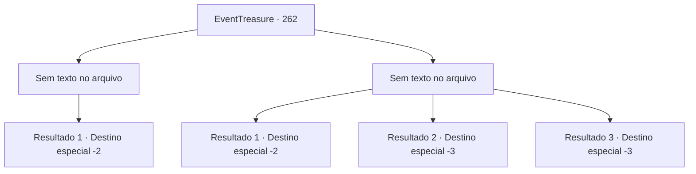

# Eventos de tesouro · 262

[Índice da tabela](index.md) · [Índice geral](../index.md)

ID: `pt:EventTreasure:262` · Fonte: `EventTreasure4` · Versão: 1.2.47.

Mapeamento estático dos arquivos; a disponibilidade e a execução dependem do estado da run.

## Texto do evento

*Sem texto no arquivo.*

## Dados de entrada

```json
{
  "id": 262,
  "grade": 1,
  "place": "",
  "required": ""
}
```

## Mapa das escolhas



## Escolhas e resultados

### Escolha 1

*Sem texto no arquivo; o papel dessa opção depende da interface do jogo.*

Requisitos e outros campos da escolha:

```json
{
  "required": ""
}
```

#### Resultado 1.1

Os goblins derrotados se dispersam e fogem. Gares tenta persegui-los com seu exército, mas era impossível rastreá-los porque se dispersaram em seis grupos. 

 "Maldição! Só te segui porque disseram que você era um aventureiro famoso!"

 Depois de não conseguir acabar com eles de uma vez por todas, Gares começa a te culpar. Enquanto és culpado sem dizer nada, abandonas a Floresta de Pailmary.

Continuação registrada: [Destino especial `-2`](../destinos-especiais.md).

```json
{
  "required": "",
  "chance": "1",
  "nextEvent": -2,
  "type": 2,
  "reward": "5_542_9"
}
```

### Escolha 2

*Sem texto no arquivo; o papel dessa opção depende da interface do jogo.*

Requisitos e outros campos da escolha:

```json
{
  "required": ""
}
```

#### Resultado 2.1


 "Retreat! Retreat!"

 With the unexpected counterattack, Gares' army retreats without even offering resistance. After hearing Gares' cry, you hide among the bushes to avoid the attack of the goblin shaman.

Continuação registrada: [Destino especial `-2`](../destinos-especiais.md).

```json
{
  "required": "1_0_2|1_1_2",
  "chance": "1",
  "nextEvent": -2,
  "type": 2,
  "reward": "0_0_-1|0_1_-1|5_542_9"
}
```

#### Resultado 2.2

A magia negra do xamã dos goblins começa a sufocar você. Você luta tentando respirar, mas acaba morrendo.

Continuação registrada: [Destino especial `-3`](../destinos-especiais.md).

```json
{
  "required": "2_0_2",
  "chance": "1",
  "nextEvent": -3,
  "type": 2,
  "reward": "0_0_-1|0_1_-1"
}
```

#### Resultado 2.3

A magia negra do xamã dos goblins começa a sufocar você. Você luta tentando respirar, mas acaba morrendo.

Continuação registrada: [Destino especial `-3`](../destinos-especiais.md).

```json
{
  "required": "2_1_2",
  "chance": "1",
  "nextEvent": -3,
  "type": 2,
  "reward": "0_0_-1|0_1_-1"
}
```

## Referências que chegam a este evento

- [Evento 260 · escolha 1 · resultado 1](0260.md#escolha-1)
- [Evento 260 · escolha 2 · resultado 1](0260.md#escolha-2)
