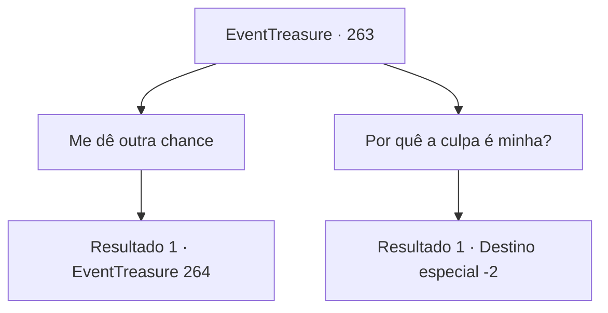

# Eventos de tesouro · 263

[Índice da tabela](index.md) · [Índice geral](../index.md)

ID: `pt:EventTreasure:263` · Fonte: `EventTreasure4` · Versão: 1.2.47.

Mapeamento estático dos arquivos; a disponibilidade e a execução dependem do estado da run.

## Texto do evento

*Sem texto no arquivo.*

## Dados de entrada

```json
{
  "id": 263,
  "grade": 1,
  "place": "",
  "required": ""
}
```

## Mapa das escolhas



## Escolhas e resultados

### Escolha 1

Me dê outra chance

Requisitos e outros campos da escolha:

```json
{
  "required": ""
}
```

#### Resultado 1.1

Você pede a Gares outra oportunidade. Com o seu pedido, Gares solta um suspiro profundo e se acalma. 

 "...Certo. Vá e mate o xamã dos goblins que está em algum lugar da floresta. Se você tiver sucesso, não te culparei pelo plano recente."

 Segundo ele, o xamã dos goblins parece ser o líder dos goblins. Você se afasta e olha em direção à floresta onde está o xamã.

Continuação registrada: [Evento 264](0264.md) na mesma tabela.

```json
{
  "required": "",
  "chance": "1",
  "nextEvent": 264,
  "type": 2,
  "reward": ""
}
```

### Escolha 2

Por quê a culpa é minha?

Requisitos e outros campos da escolha:

```json
{
  "required": ""
}
```

#### Resultado 2.1

À medida que você começa a discutir, Gares encolhe como se achasse absurdo. Ele balança a cabeça e te manda embora com um gesto de mão. 

 "Suspiro, sério mesmo...? Seja lá o que for. Saia da minha vista agora mesmo. Maldito aventureiro."

 Gares se dirige a algum lugar da floresta com cara de raiva. Você caminha na direção oposta e abandona a Floresta Pailmary.

Continuação registrada: [Destino especial `-2`](../destinos-especiais.md).

```json
{
  "required": "",
  "chance": "1",
  "nextEvent": -2,
  "type": 2,
  "reward": "5_542_9"
}
```

## Referências que chegam a este evento

- [Evento 258 · escolha 1 · resultado 1](0258.md#escolha-1)
- [Evento 259 · escolha 1 · resultado 1](0259.md#escolha-1)
