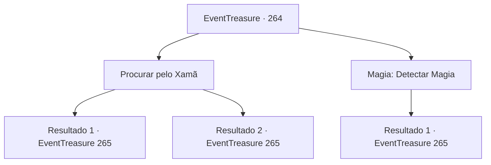

# Eventos de tesouro · 264

[Índice da tabela](index.md) · [Índice geral](../index.md)

ID: `pt:EventTreasure:264` · Fonte: `EventTreasure4` · Versão: 1.2.47.

Mapeamento estático dos arquivos; a disponibilidade e a execução dependem do estado da run.

## Texto do evento

*Sem texto no arquivo.*

## Dados de entrada

```json
{
  "id": 264,
  "grade": 1,
  "place": "",
  "required": ""
}
```

## Mapa das escolhas



## Escolhas e resultados

### Escolha 1

Procurar pelo Xamã

Requisitos e outros campos da escolha:

```json
{
  "required": ""
}
```

#### Resultado 1.1

Você caminha pela Floresta Pailmary em busca do xamã dos goblins. Surpreendentemente, há muitas pegadas na vasta floresta. Desde a linguagem dos goblins escrita nas rochas até pegadas de tamanho anormal e acessórios rudimentares. Seguindo várias pegadas, você consegue encontrar o xamã dos goblins em uma hora. 

 "Ele é um xamã. Não podemos perdê-lo."

 Há alguns goblins que parecem ser os capangas do xamã dos goblins por perto. Você saca sua arma e ataca com Gares.

Continuação registrada: [Evento 265](0265.md) na mesma tabela.

```json
{
  "required": "",
  "chance": "1|0_14_1",
  "nextEvent": 265,
  "type": 0,
  "reward": "6_0_23",
  "place": 1
}
```

#### Resultado 1.2

Você caminha pela Floresta Pailmary em busca do xamã dos goblins. No entanto, em vez de encontrar o xamã, você fica ainda mais exausto ao atravessar a vasta floresta. Nesse momento, um grupo de goblins escondidos nas árvores te ataca repentinamente. 

 "¡Kyahh!"

 O xamã dos goblins, que você e Gares estavam procurando, também está entre eles. 

 "¡Maldição! ¡Você não é de nenhuma ajuda! ¡Nos permitindo ser emboscados duas vezes em um único dia!"

 Gares se apoia em suas costas enquanto xinga. Pouco depois do comando do xamã, o grupo de goblins ataca.

Continuação registrada: [Evento 265](0265.md) na mesma tabela.

```json
{
  "required": "",
  "chance": "15",
  "nextEvent": 265,
  "type": 1,
  "reward": "6_3_23",
  "place": 1
}
```

### Escolha 2

Magia: Detectar Magia

Requisitos e outros campos da escolha:

```json
{
  "required": "20_0_1"
}
```

#### Resultado 2.1

Lanças Detectar Magia e procuras pelo xamã goblin. Felizmente, encontras vestígios de magia que se supõe serem do xamã por toda a floresta. Começas a seguir lentamente os vestígios de magia. Após uma hora de caminhada, vês o xamã goblin descansando numa área vazia. 

 "É um xamã. Não podemos perdê-lo."

 Há alguns goblins que parecem ser os capangas do xamã goblin por perto. Retiras a tua arma e atacas com Gares.

Continuação registrada: [Evento 265](0265.md) na mesma tabela.

```json
{
  "required": "",
  "chance": "1",
  "nextEvent": 265,
  "type": 2,
  "reward": "6_0_23",
  "place": 1
}
```

## Referências que chegam a este evento

- [Evento 263 · escolha 1 · resultado 1](0263.md#escolha-1)
