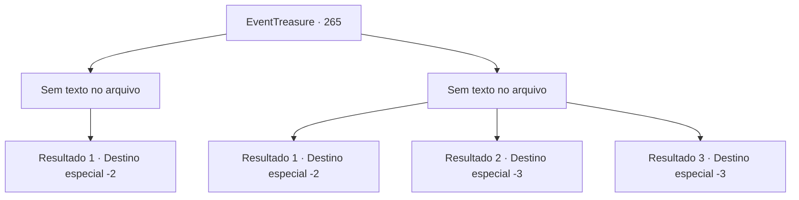

# Eventos de tesouro · 265

[Índice da tabela](index.md) · [Índice geral](../index.md)

ID: `pt:EventTreasure:265` · Fonte: `EventTreasure4` · Versão: 1.2.47.

Mapeamento estático dos arquivos; a disponibilidade e a execução dependem do estado da run.

## Texto do evento

*Sem texto no arquivo.*

## Dados de entrada

```json
{
  "id": 265,
  "grade": 1,
  "place": "",
  "required": ""
}
```

## Mapa das escolhas



## Escolhas e resultados

### Escolha 1

*Sem texto no arquivo; o papel dessa opção depende da interface do jogo.*

Requisitos e outros campos da escolha:

```json
{
  "required": ""
}
```

#### Resultado 1.1

O xamã duende com o pescoço quebrado ofega por ar, mas morre. Quando olhas ao redor, encontras os outros duendes mortos no chão. Guardas tua arma e te aproximas de Gares. Gares sacode a poeira com uma expressão insatisfeita. 

 "Tch. Não te culparei como prometi. No entanto, é tua culpa que todos os meus homens tenham morrido, então nem menciones uma recompensa."

 Depois de te olhar com raiva, ele vai para algum lugar da floresta. Caminhas na direção oposta e abandonas a Floresta de Pailmary.

Continuação registrada: [Destino especial `-2`](../destinos-especiais.md).

```json
{
  "required": "",
  "chance": "1",
  "nextEvent": -2,
  "type": 2,
  "reward": "5_542_9"
}
```

### Escolha 2

*Sem texto no arquivo; o papel dessa opção depende da interface do jogo.*

Requisitos e outros campos da escolha:

```json
{
  "required": ""
}
```

#### Resultado 2.1


 "Ugh! Ugh...! Ugh!"

 Depois de ser atacado pelas costas pelo xamã duende, Gares cai. Seus olhos estão virados e ele não consegue mais se levantar. Ainda insatisfeito, o xamã duende e seu grupo de duendes te perseguem. Ao perceber que está derrotado, você deixa o cadáver de Gares para trás e foge.

Continuação registrada: [Destino especial `-2`](../destinos-especiais.md).

```json
{
  "required": "1_0_2|1_1_2",
  "chance": "1",
  "nextEvent": -2,
  "type": 2,
  "reward": "0_0_-1|0_1_-1|5_542_9"
}
```

#### Resultado 2.2

O feitiço maligno do xamã duende drena sua força. Você cai no chão porque não tem força para se manter de pé, e seus olhos se fecham porque não tem força para abri-los. No final, você para de respirar porque não tem força nem mesmo para respirar.

Continuação registrada: [Destino especial `-3`](../destinos-especiais.md).

```json
{
  "required": "2_0_2",
  "chance": "1",
  "nextEvent": -3,
  "type": 2,
  "reward": "0_0_-1|0_1_-1"
}
```

#### Resultado 2.3

O feitiço maligno do xamã duende drena sua força. Você cai no chão porque não tem força para se manter de pé, e seus olhos se fecham porque não tem força para abri-los. No final, você para de respirar porque não tem força nem mesmo para respirar.

Continuação registrada: [Destino especial `-3`](../destinos-especiais.md).

```json
{
  "required": "2_1_2",
  "chance": "1",
  "nextEvent": -3,
  "type": 2,
  "reward": "0_0_-1|0_1_-1"
}
```

## Referências que chegam a este evento

- [Evento 264 · escolha 1 · resultado 1](0264.md#escolha-1)
- [Evento 264 · escolha 1 · resultado 2](0264.md#escolha-1)
- [Evento 264 · escolha 2 · resultado 1](0264.md#escolha-2)
