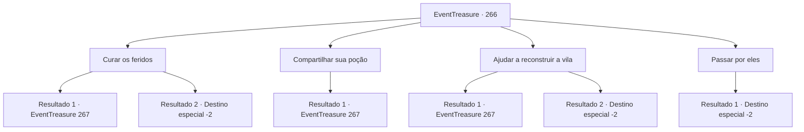

# Eventos de tesouro · 266

[Índice da tabela](index.md) · [Índice geral](../index.md)

ID: `pt:EventTreasure:266` · Fonte: `EventTreasure4` · Versão: 1.2.47.

Mapeamento estático dos arquivos; a disponibilidade e a execução dependem do estado da run.

## Texto do evento

|drawing_ruinedVillage| 

 "Ah, por favor nos ajude, aventureiro!"

 Você chega a uma vila que está devastada como se tivesse ocorrido um desastre natural. Os edifícios estão demolidos, os feridos estão espalhados por todo o lado e parece que ficaram sem água e comida. Os aldeões vêm e pedem desesperadamente qualquer tipo de ajuda. Seu olhar permanece em suas aparências sujas.

## Dados de entrada

```json
{
  "id": 266,
  "grade": 2,
  "place": "",
  "required": "1_2_50|5_543_0|26_11_1"
}
```

## Mapa das escolhas



## Escolhas e resultados

### Escolha 1

Curar os feridos

Requisitos e outros campos da escolha:

```json
{
  "required": "1_1_2"
}
```

#### Resultado 1.1

Você reúne os feridos em um só lugar e começa a cuidar deles. As lesões dos aldeões são muito diversas, desde abrasões até queimaduras, fraturas e sangramentos. Você cuidou ansiosamente dos feridos até altas horas da noite. 

 Na manhã seguinte, outros aldeões vêm até você enquanto tenta sair da vila. O número deles parece ter aumentado em comparação com a noite anterior. 

 "Aventureiro, por favor me ajude! Estou sofrendo muita dor!"

 "Por favor, cuide primeiro do meu filho! Eu te imploro!"

 Você se sente mentalmente exausto com os feridos que constantemente vêm até você.

Continuação registrada: [Evento 267](0267.md) na mesma tabela.

```json
{
  "required": "",
  "chance": "1|0_14_1",
  "nextEvent": 267,
  "type": 0,
  "reward": "0_3_1|0_1_-1|5_543_1"
}
```

#### Resultado 1.2

Você reúne os feridos em um só lugar e começa a curá-los. No entanto, suas habilidades não são capazes de curar nada além de pequenos arranhões. Por fim, você apenas veste as crianças e abandona a vila.

Continuação registrada: [Destino especial `-2`](../destinos-especiais.md).

```json
{
  "required": "",
  "chance": "10",
  "nextEvent": -2,
  "type": 1,
  "reward": "5_543_9"
}
```

### Escolha 2

Compartilhar sua poção

Requisitos e outros campos da escolha:

```json
{
  "required": "23_6_1|1_1_2"
}
```

#### Resultado 2.1

Você usa todas e cada uma de suas poções para curar os aldeões. Você divide suas poções o mínimo possível para curar a maior quantidade de pessoas possível, pois não tinha tantas poções. Você cuidou incansavelmente dos feridos até altas horas da noite. 

 Na manhã seguinte, outros aldeões vêm até você enquanto tenta deixar a vila. O número deles parece ter aumentado em comparação com a noite anterior. 

 " Aventureiro, por favor, me ajude! Estou sofrendo muita dor!"

 "Por favor, cuide primeiro do meu filho! Eu te imploro!"

 Você se sente mentalmente exausto com os feridos que constantemente vêm até você.

Continuação registrada: [Evento 267](0267.md) na mesma tabela.

```json
{
  "required": "",
  "chance": "1",
  "nextEvent": 267,
  "type": 2,
  "reward": "25_6_1|0_1_-1|5_543_1|0_3_3"
}
```

### Escolha 3

Ajudar a reconstruir a vila

Requisitos e outros campos da escolha:

```json
{
  "required": "1_0_2"
}
```

#### Resultado 3.1

Você contribui com trabalho duro em vez dos aldeões feridos. Há tantas coisas para fazer, desde procurar pessoas desaparecidas até transportar os feridos e construir um acampamento temporário. Você continua trabalhando incansavelmente até altas horas da noite. 

 Na manhã seguinte, outros aldeões se aproximam de você enquanto você tenta sair da vila. O número deles parece ter aumentado em comparação com a noite anterior. 

 "Aventureiro, por favor me ajude! Meu irmão mais novo está preso!"

 "Temos que mover os materiais primeiro! Se não fizermos isso, não conseguiremos alcançar hoje!"

 Você se sente fisicamente exausto com os feridos que constantemente vêm até você.

Continuação registrada: [Evento 267](0267.md) na mesma tabela.

```json
{
  "required": "",
  "chance": "1|0_5_1",
  "nextEvent": 267,
  "type": 0,
  "reward": "0_3_1|0_0_-1|5_543_1"
}
```

#### Resultado 3.2

Tentaste ajudar os moradores, mas acabaste sendo um obstáculo. Dizem que já não precisam da tua ajuda, e assim abandonas a vila, sentindo-te como se estivessem te expulsando.

Continuação registrada: [Destino especial `-2`](../destinos-especiais.md).

```json
{
  "required": "",
  "chance": "12",
  "nextEvent": -2,
  "type": 1,
  "reward": "5_543_9"
}
```

### Escolha 4

Passar por eles

Requisitos e outros campos da escolha:

```json
{
  "required": ""
}
```

#### Resultado 4.1

Ignoras as solicitações dos aldeões e abandona a vila.

Continuação registrada: [Destino especial `-2`](../destinos-especiais.md).

```json
{
  "required": "",
  "chance": "1",
  "nextEvent": -2,
  "type": 2,
  "reward": "5_543_9"
}
```

## Referências que chegam a este evento

Nenhum `nextEvent` positivo da mesma tabela aponta para este nó. Isso não prova que seja inacessível: sorteio e estado de história podem selecioná-lo.

