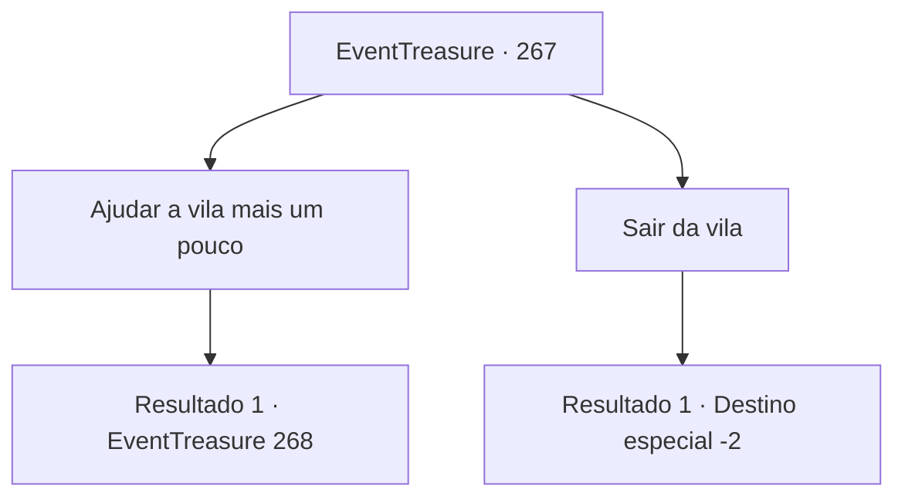

# Eventos de tesouro · 267

[Índice da tabela](index.md) · [Índice geral](../index.md)

ID: `pt:EventTreasure:267` · Fonte: `EventTreasure4` · Versão: 1.2.47.

Mapeamento estático dos arquivos; a disponibilidade e a execução dependem do estado da run.

## Texto do evento

*Sem texto no arquivo.*

## Dados de entrada

```json
{
  "id": 267,
  "grade": 1,
  "place": "",
  "required": ""
}
```

## Mapa das escolhas



## Escolhas e resultados

### Escolha 1

Ajudar a vila mais um pouco

Requisitos e outros campos da escolha:

```json
{
  "required": "1_3_25"
}
```

#### Resultado 1.1

Você supera o cansaço e continua ajudando o povo mais uma vez. À medida que você ajuda, o povo começa a mudar lentamente. Após alguns dias, ocorre uma agitação repentina. O caçador de trolls que apareceu de uma montanha próxima começa a causar caos no meio do povoado. Até mesmo o abrigo temporário para evitar a chuva e as cercas do povoado são destruídos pelo caçador de trolls. 

 "Monstro! O monstro que destruiu o povoado voltou novamente!"

 "Ah! Socorro! Aventureiro!"

 Você descobre que o povoado foi destruído pelo caçador de trolls. Logo, a agitação furiosa do caçador de trolls se aproxima de você.

Continuação registrada: [Evento 268](0268.md) na mesma tabela.

```json
{
  "required": "",
  "chance": "1",
  "nextEvent": 268,
  "type": 0,
  "reward": "6_0_39",
  "place": 13
}
```

### Escolha 2

Sair da vila

Requisitos e outros campos da escolha:

```json
{
  "required": ""
}
```

#### Resultado 2.1

Ignoras as constantes solicitações dos aldeões e abandona a vila.

Continuação registrada: [Destino especial `-2`](../destinos-especiais.md).

```json
{
  "required": "",
  "chance": "1",
  "nextEvent": -2,
  "type": 2,
  "reward": "5_543_9"
}
```

## Referências que chegam a este evento

- [Evento 266 · escolha 1 · resultado 1](0266.md#escolha-1)
- [Evento 266 · escolha 2 · resultado 1](0266.md#escolha-2)
- [Evento 266 · escolha 3 · resultado 1](0266.md#escolha-3)
