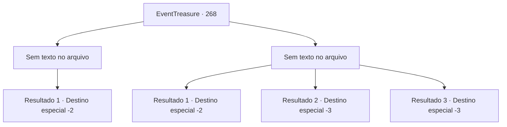

# Eventos de tesouro · 268

[Índice da tabela](index.md) · [Índice geral](../index.md)

ID: `pt:EventTreasure:268` · Fonte: `EventTreasure4` · Versão: 1.2.47.

Mapeamento estático dos arquivos; a disponibilidade e a execução dependem do estado da run.

## Texto do evento

*Sem texto no arquivo.*

## Dados de entrada

```json
{
  "id": 268,
  "grade": 1,
  "place": "",
  "required": ""
}
```

## Mapa das escolhas



## Escolhas e resultados

### Escolha 1

*Sem texto no arquivo; o papel dessa opção depende da interface do jogo.*

Requisitos e outros campos da escolha:

```json
{
  "required": ""
}
```

#### Resultado 1.1

Depois de derrotar o caçador de trolls, você corta sua cabeça e a coloca na entrada da vila. É para enviar um aviso aos outros monstros. 

 "Obrigado, muito obrigado. Aventureiro. Você é verdadeiramente nosso 'salvador'."

 Após a batalha, os aldeões se reúnem ao seu redor e expressam sua gratidão. Você acena com a cabeça e volta a ajudar a vila. 

 Na manhã seguinte, você deixa a vila queimada. Talvez graças à sua contribuição, a vila parece estar voltando ao seu estado original. Os aldeões se despedem de você e você continua sua jornada.

Continuação registrada: [Destino especial `-2`](../destinos-especiais.md).

```json
{
  "required": "",
  "chance": "1",
  "nextEvent": -2,
  "type": 2,
  "reward": "27_31_1|5_543_9"
}
```

### Escolha 2

*Sem texto no arquivo; o papel dessa opção depende da interface do jogo.*

Requisitos e outros campos da escolha:

```json
{
  "required": ""
}
```

#### Resultado 2.1

Depois de ser derrotado pelo caçador de trolls, você abandona a vila e foge.

Continuação registrada: [Destino especial `-2`](../destinos-especiais.md).

```json
{
  "required": "1_0_2|1_1_2",
  "chance": "1",
  "nextEvent": -2,
  "type": 2,
  "reward": "0_0_-1|0_1_-1|5_543_9"
}
```

#### Resultado 2.2

O caçador de trolls destrói tudo na vila. Junto com tudo o mais, sua cabeça também fica esmagada.

Continuação registrada: [Destino especial `-3`](../destinos-especiais.md).

```json
{
  "required": "2_0_2",
  "chance": "1",
  "nextEvent": -3,
  "type": 2,
  "reward": "0_0_-1|0_1_-1"
}
```

#### Resultado 2.3

O caçador de trolls destrói tudo na vila. Junto com tudo o mais, sua cabeça também fica esmagada.

Continuação registrada: [Destino especial `-3`](../destinos-especiais.md).

```json
{
  "required": "2_1_2",
  "chance": "1",
  "nextEvent": -3,
  "type": 2,
  "reward": "0_0_-1|0_1_-1"
}
```

## Referências que chegam a este evento

- [Evento 267 · escolha 1 · resultado 1](0267.md#escolha-1)
