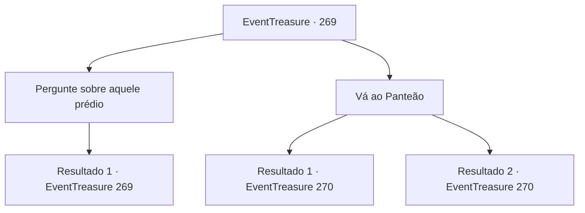

# Eventos de tesouro · 269

[Índice da tabela](index.md) · [Índice geral](../index.md)

ID: `pt:EventTreasure:269` · Fonte: `EventTreasure4` · Versão: 1.2.47.

Mapeamento estático dos arquivos; a disponibilidade e a execução dependem do estado da run.

## Texto do evento

Você se depara com uma estrutura construída no topo de uma montanha rochosa.  Parece ser esculpido em pedra branca pura, encimado por um teto em forma de cúpula.  Algumas pessoas estão subindo os degraus de pedra em direção ao prédio.

## Dados de entrada

```json
{
  "id": 269,
  "grade": 2,
  "place": "",
  "required": "1_2_50|5_544_0|18_432_1|26_20_1"
}
```

## Mapa das escolhas



## Escolhas e resultados

### Escolha 1

Pergunte sobre aquele prédio

Requisitos e outros campos da escolha:

```json
{
  "required": "5_545_0"
}
```

#### Resultado 1.1

Você perguntou a um idoso o que estava acontecendo com o prédio no topo. Ele olha de soslaio para você e responde: 

 "Hmm? Você está se referindo a esse templo? Isso é o 'Panteão'. É um lugar onde todos os tipos de deuses são venerados e oferendas são feitas. Pessoas de diversas crenças se reúnem aqui para pedir ajuda aos deuses."

 Depois de terminar suas palavras, o idoso deu tapinhas em sua cintura e subiu as escadas.

Continuação registrada: [Evento 269](0269.md) na mesma tabela.

```json
{
  "required": "",
  "chance": "1",
  "nextEvent": 269,
  "type": 2,
  "reward": "5_545_1"
}
```

### Escolha 2

Vá ao Panteão

Requisitos e outros campos da escolha:

```json
{
  "required": "-1|5_545_1|1_7_12"
}
```

#### Resultado 2.1

Você vai ao Panteão, como o ancião lhe informou. |drawing_pantheon| Ao entrar no prédio de pedra branca pura, você vê várias esculturas colocadas aqui e ali, cada uma representando a imagem de um deus. O templo está dividido em duas partes principais, uma é 'corpo' e a outra é 'mente'.

Continuação registrada: [Evento 270](0270.md) na mesma tabela.

```json
{
  "required": "5_545_1",
  "chance": "1",
  "nextEvent": 270,
  "type": 2,
  "reward": "5_544_1"
}
```

#### Resultado 2.2

Você percebe que o prédio é um Panteão, um lugar que adora e oferece sacrifícios a vários deuses. Seguindo as pessoas, você vai ao Panteão. |drawing_pantheon| Ao entrar no prédio de pedra branca pura, você vê várias esculturas colocadas aqui e ali, cada uma representando a imagem de um deus. O templo está dividido em duas partes principais, uma é 'corpo' e a outra é 'mente'.

Continuação registrada: [Evento 270](0270.md) na mesma tabela.

```json
{
  "required": "18_545_1",
  "chance": "1",
  "nextEvent": 270,
  "type": 2,
  "reward": "5_544_1"
}
```

## Referências que chegam a este evento

- [Evento 269 · escolha 1 · resultado 1](0269.md#escolha-1)
