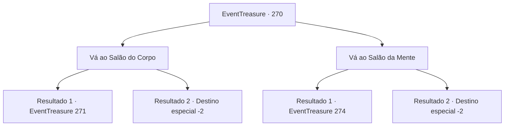

# Eventos de tesouro · 270

[Índice da tabela](index.md) · [Índice geral](../index.md)

ID: `pt:EventTreasure:270` · Fonte: `EventTreasure4` · Versão: 1.2.47.

Mapeamento estático dos arquivos; a disponibilidade e a execução dependem do estado da run.

## Texto do evento

*Sem texto no arquivo.*

## Dados de entrada

```json
{
  "id": 270,
  "grade": 1,
  "place": "",
  "required": ""
}
```

## Mapa das escolhas



## Escolhas e resultados

### Escolha 1

Vá ao Salão do Corpo

Requisitos e outros campos da escolha:

```json
{
  "required": ""
}
```

#### Resultado 1.1

Você se dirige à Sala do Corpo. Fiel ao seu nome, está cheia de estátuas musculosamente esculpidas de deuses, e a luz do sol que entra pelo teto em forma de cúpula adiciona uma atmosfera sagrada. Entre as muitas pessoas que oferecem suas orações, aproxima-se um sacerdote musculoso vestido com uma túnica branca e fala com você. 

 "Bem-vindo, percebo uma fé fiel em você. Então, você está considerando fazer o teste dos deuses?"


Continuação registrada: [Evento 271](0271.md) na mesma tabela.

```json
{
  "required": "20_3_2",
  "chance": "1",
  "nextEvent": 271,
  "type": 2,
  "reward": ""
}
```

#### Resultado 1.2

Você se dirige à Sala do corpo. Fiel ao seu nome, está cheia de estátuas esculpidas muscularmente de deuses, e a luz do sol que entra pelo teto em forma de cúpula adiciona uma atmosfera sagrada. Você observa as estátuas e, encontrando uma que gosta, para para rezar diante dela. Em seguida, você sai do panteão.

Continuação registrada: [Destino especial `-2`](../destinos-especiais.md).

```json
{
  "required": "21_3_2",
  "chance": "1",
  "nextEvent": -2,
  "type": 2,
  "reward": "5_544_9"
}
```

### Escolha 2

Vá ao Salão da Mente

Requisitos e outros campos da escolha:

```json
{
  "required": ""
}
```

#### Resultado 2.1

Você se dirige à Sala da Mente. A sala é revestida com tábuas de pedra inscritas com as palavras dos deuses, e a fumaça que sobe dos queimadores de incenso de bronze colocados por todo o espaço cria uma atmosfera mística. Entre as muitas pessoas que oferecem suas orações, um sacerdote se aproxima usando óculos redondos e fala com você. 

 "Bem-vindo. Percebo uma fé fiel em você."

 Ele faz uma pausa para te olhar antes de continuar. 

 "Então devo perguntar, você está considerando fazer o teste dos deuses?"


Continuação registrada: [Evento 274](0274.md) na mesma tabela.

```json
{
  "required": "20_3_2",
  "chance": "1",
  "nextEvent": 274,
  "type": 2,
  "reward": ""
}
```

#### Resultado 2.2

Você se dirige à Sala da Mente. A sala é revestida com tábuas de pedra inscritas com as palavras dos deuses, e a fumaça que sobe dos queimadores de incenso de bronze colocados por todo o espaço adiciona uma atmosfera mística. Você observa as estátuas e, encontrando uma que gosta, para para rezar em frente a ela. Depois, você sai do panteão.

Continuação registrada: [Destino especial `-2`](../destinos-especiais.md).

```json
{
  "required": "21_3_2",
  "chance": "1",
  "nextEvent": -2,
  "type": 2,
  "reward": "5_544_9"
}
```

## Referências que chegam a este evento

- [Evento 269 · escolha 2 · resultado 1](0269.md#escolha-2)
- [Evento 269 · escolha 2 · resultado 2](0269.md#escolha-2)
