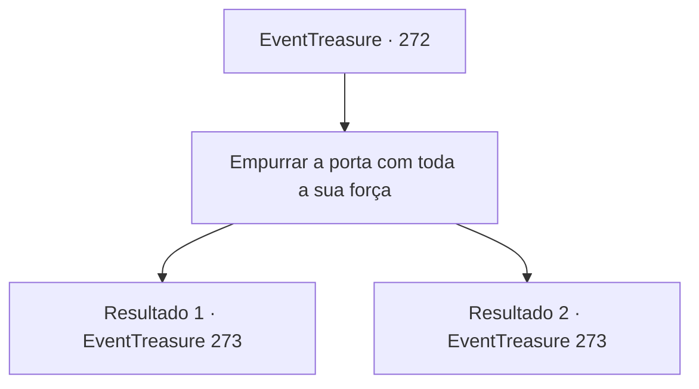

# Eventos de tesouro · 272

[Índice da tabela](index.md) · [Índice geral](../index.md)

ID: `pt:EventTreasure:272` · Fonte: `EventTreasure4` · Versão: 1.2.47.

Mapeamento estático dos arquivos; a disponibilidade e a execução dependem do estado da run.

## Texto do evento

*Sem texto no arquivo.*

## Dados de entrada

```json
{
  "id": 272,
  "grade": 1,
  "place": "",
  "required": ""
}
```

## Mapa das escolhas



## Escolhas e resultados

### Escolha 1

Empurrar a porta com toda a sua força

Requisitos e outros campos da escolha:

```json
{
  "required": ""
}
```

#### Resultado 1.1

Você empurrou a pesada porta de ferro com todas as suas forças. A porta pesada abriu rangendo, rasgando o chão de pedra. O sacerdote musculoso parece desconcertado e diz. 

 "Hmm... Supostamente a porta deveria ser puxada para abrir... De qualquer forma, com um corpo tão treinado, os deuses ficarão satisfeitos."

 Atrás da pesada porta há uma pequena sala com janelas nos quatro cantos, deixando entrar a luz do sol. Na sala, há apenas um altar de pedra, sobre o qual repousa uma grande bola de ferro. O sacerdote bate na bola com a mão e diz. 

 "Agora, levante essa bola. E recite a oração gravada aqui."

 Olhando para onde o sacerdote aponta, há uma longa oração gravada na parte inferior do altar de pedra.

Continuação registrada: [Evento 273](0273.md) na mesma tabela.

```json
{
  "required": "",
  "chance": "1|0_5_1",
  "nextEvent": 273,
  "type": 0,
  "reward": ""
}
```

#### Resultado 1.2

Você empurrou a pesada porta de ferro com todas as suas forças. No entanto, a porta não se move. 

 "Hmm... Puxe a alça."

 Você faz o que o padre diz, puxando a porta, e ao contrário do antes, a porta se abre suavemente. O padre se desculpa por não ter te dito antes e te guia. Você o segue em direção ao estreito quarto atrás da porta. Atrás da pesada porta há um pequeno quarto com janelas nos quatro cantos, deixando a luz do sol entrar. No quarto, há apenas um altar de pedra, sobre o qual repousa uma grande bola de ferro. O padre bate na bola com a mão e diz, 

 "Agora, levante essa bola. E recite a oração gravada aqui."

 Olhando para onde o padre aponta, há uma longa oração gravada na parte inferior do altar de pedra.

Continuação registrada: [Evento 273](0273.md) na mesma tabela.

```json
{
  "required": "",
  "chance": "14",
  "nextEvent": 273,
  "type": 1,
  "reward": ""
}
```

## Referências que chegam a este evento

- [Evento 271 · escolha 1 · resultado 1](0271.md#escolha-1)
