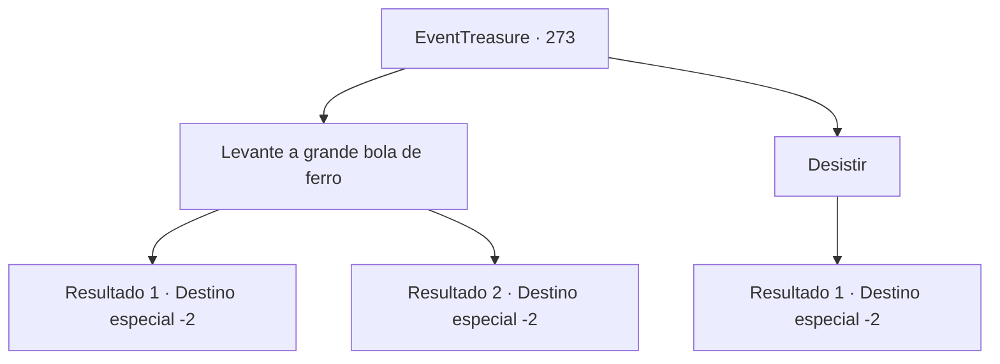

# Eventos de tesouro · 273

[Índice da tabela](index.md) · [Índice geral](../index.md)

ID: `pt:EventTreasure:273` · Fonte: `EventTreasure4` · Versão: 1.2.47.

Mapeamento estático dos arquivos; a disponibilidade e a execução dependem do estado da run.

## Texto do evento

*Sem texto no arquivo.*

## Dados de entrada

```json
{
  "id": 273,
  "grade": 1,
  "place": "",
  "required": ""
}
```

## Mapa das escolhas



## Escolhas e resultados

### Escolha 1

Levante a grande bola de ferro

Requisitos e outros campos da escolha:

```json
{
  "required": "1_0_2"
}
```

#### Resultado 1.1

Você levantou a grande bola de ferro sobre suas costas e recitou a oração gravada no altar de pedra. Foi uma tarefa incrivelmente difícil, que exigia força, equilíbrio e resistência, mas você conseguiu realizá-la esplendidamente. Quando termina a oração e deixa cair a bola de ferro, o padre musculoso aplaude e diz: 

 "Excelente! Você passou no teste. Os deuses do Panteão te abençoarão. Que a glória esteja em seu caminho!"

 Talvez devido às suas palavras, você sente como se estivesse sendo envolvido pela luz. Tendo completado o teste, você troca cumprimentos com o padre e sai do Panteão.

Continuação registrada: [Destino especial `-2`](../destinos-especiais.md).

```json
{
  "required": "",
  "chance": "1|0_5_1|0_13_1|0_6_1",
  "nextEvent": -2,
  "type": 0,
  "reward": "27_36_1|0_0_1|5_544_9|0_2_1"
}
```

#### Resultado 1.2

A duras penas conseguiu levantar a grande bola de ferro sobre suas costas e recitar a oração gravada no altar de pedra. No entanto, antes de terminar de recitar, você perde o controle da bola. Ela cai, deixando uma amassadura no chão de pedra. 

 "Oh, é uma pena. Embora você não tenha passado no teste, não se preocupe muito. Os deuses sempre cuidam de você. Desejo-lhe boa sorte."

 Após o teste, você sai do Panteão enquanto massageia sua cintura dolorida.

Continuação registrada: [Destino especial `-2`](../destinos-especiais.md).

```json
{
  "required": "",
  "chance": "30",
  "nextEvent": -2,
  "type": 1,
  "reward": "5_544_9|0_0_-1"
}
```

### Escolha 2

Desistir

Requisitos e outros campos da escolha:

```json
{
  "required": ""
}
```

#### Resultado 2.1

Você disse que sua condição não era boa o suficiente para fazer o exame. O sacerdote musculoso responde com uma expressão de pesar, 

 "Ah, é uma pena. Embora você não tenha passado no exame, não se preocupe muito. Os deuses sempre cuidam de você. Desejo boa sorte."

 Depois de desistir do exame, você troca saudações com o sacerdote e sai do Panteão.

Continuação registrada: [Destino especial `-2`](../destinos-especiais.md).

```json
{
  "required": "",
  "chance": "1",
  "nextEvent": -2,
  "type": 2,
  "reward": "5_544_9"
}
```

## Referências que chegam a este evento

- [Evento 272 · escolha 1 · resultado 1](0272.md#escolha-1)
- [Evento 272 · escolha 1 · resultado 2](0272.md#escolha-1)
