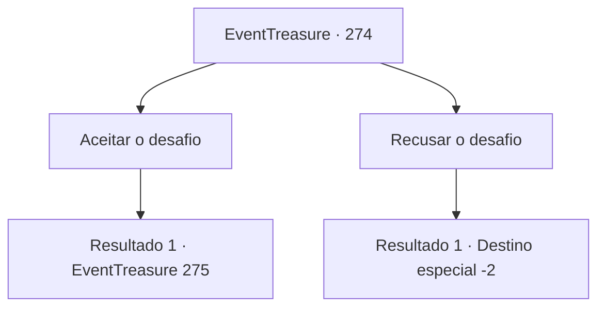

# Eventos de tesouro · 274

[Índice da tabela](index.md) · [Índice geral](../index.md)

ID: `pt:EventTreasure:274` · Fonte: `EventTreasure4` · Versão: 1.2.47.

Mapeamento estático dos arquivos; a disponibilidade e a execução dependem do estado da run.

## Texto do evento

*Sem texto no arquivo.*

## Dados de entrada

```json
{
  "id": 274,
  "grade": 1,
  "place": "",
  "required": ""
}
```

## Mapa das escolhas



## Escolhas e resultados

### Escolha 1

Aceitar o desafio

Requisitos e outros campos da escolha:

```json
{
  "required": ""
}
```

#### Resultado 1.1

Você respondeu que faria o teste dos deuses. O sacerdote assente com uma expressão solene e te guia para um quarto mais profundo. O chão do corredor estreito e longo está coberto por um longo tapete azul, e prateleiras se alinham dos dois lados, chegando até o teto. E no final, há um pequeno quarto escondido por um véu. O sacerdote te olha e diz, 

 "Agora, se você levantar este véu e entrar, o teste começará."


Continuação registrada: [Evento 275](0275.md) na mesma tabela.

```json
{
  "required": "",
  "chance": "1",
  "nextEvent": 275,
  "type": 2,
  "reward": ""
}
```

### Escolha 2

Recusar o desafio

Requisitos e outros campos da escolha:

```json
{
  "required": ""
}
```

#### Resultado 2.1

Você respondeu que simplesmente rezaria e depois iria embora. O padre concorda com a cabeça e vai para um canto do quarto. Você olha ao redor as estátuas e, encontrando uma que gosta, para para rezar em frente a ela. Depois você sai do panteão.

Continuação registrada: [Destino especial `-2`](../destinos-especiais.md).

```json
{
  "required": "",
  "chance": "1",
  "nextEvent": -2,
  "type": 2,
  "reward": "5_544_9"
}
```

## Referências que chegam a este evento

- [Evento 270 · escolha 2 · resultado 1](0270.md#escolha-2)
