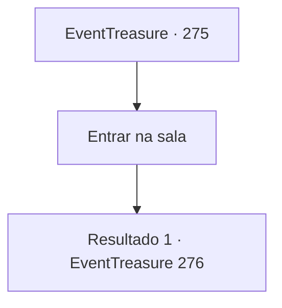

# Eventos de tesouro · 275

[Índice da tabela](index.md) · [Índice geral](../index.md)

ID: `pt:EventTreasure:275` · Fonte: `EventTreasure4` · Versão: 1.2.47.

Mapeamento estático dos arquivos; a disponibilidade e a execução dependem do estado da run.

## Texto do evento

*Sem texto no arquivo.*

## Dados de entrada

```json
{
  "id": 275,
  "grade": 1,
  "place": "",
  "required": ""
}
```

## Mapa das escolhas



## Escolhas e resultados

### Escolha 1

Entrar na sala

Requisitos e outros campos da escolha:

```json
{
  "required": ""
}
```

#### Resultado 1.1

Você levantou o véu e entrou na pequena sala. Na sala escura sem janelas, há tochas azuis colocadas nos quatro cantos e um altar de pedra no centro. Nesse altar, há uma tigela brilhante e negra cheia de água que brilha suavemente. 

 "Mergulhe seu rosto nessa água e aceite o teste que os deuses lhe dão."

 Ele examina brevemente sua tez antes de acrescentar, 

 "Se você estiver em um estado mental ruim, talvez seja melhor não fazê-lo. O teste pode ser extremamente difícil."


Continuação registrada: [Evento 276](0276.md) na mesma tabela.

```json
{
  "required": "",
  "chance": "1",
  "nextEvent": 276,
  "type": 2,
  "reward": ""
}
```

## Referências que chegam a este evento

- [Evento 274 · escolha 1 · resultado 1](0274.md#escolha-1)
