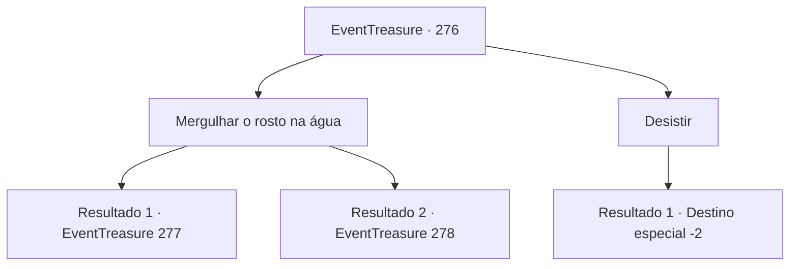

# Eventos de tesouro · 276

[Índice da tabela](index.md) · [Índice geral](../index.md)

ID: `pt:EventTreasure:276` · Fonte: `EventTreasure4` · Versão: 1.2.47.

Mapeamento estático dos arquivos; a disponibilidade e a execução dependem do estado da run.

## Texto do evento

*Sem texto no arquivo.*

## Dados de entrada

```json
{
  "id": 276,
  "grade": 1,
  "place": "",
  "required": ""
}
```

## Mapa das escolhas



## Escolhas e resultados

### Escolha 1

Mergulhar o rosto na água

Requisitos e outros campos da escolha:

```json
{
  "required": "1_1_2"
}
```

#### Resultado 1.1

Você mergulha seu rosto na água brilhante e imediatamente é arrastado. Ao abrir os olhos, percebe que está flutuando em um reino nebuloso e etéreo. A densa névoa dificulta ver claramente, mas você sente movimento dentro dela. Logo, uma figura colossal emerge da névoa, avançando em sua direção em um ataque. Você observa calmamente a figura e, enquanto o faz, gradualmente ela diminui de tamanho até se transformar em um pequeno demônio. 

 "Rosnado..."

 O diminuto demônio rosna e se lança em sua direção.

Continuação registrada: [Evento 277](0277.md) na mesma tabela.

```json
{
  "required": "",
  "chance": "1|0_14_1|0_7_1|0_12_1",
  "nextEvent": 277,
  "type": 0,
  "reward": "6_0_68",
  "place": 3
}
```

#### Resultado 1.2

Você mergulha seu rosto na água brilhante e imediatamente é arrastado. Ao abrir os olhos, percebe que está flutuando em um reino nebuloso e etéreo. A densa névoa dificulta ver claramente, mas você sente movimento dentro dela. Logo, uma figura colossal emerge da névoa, avançando em sua direção em um ataque. Você entra em pânico e luta enquanto a entidade se transforma em um demônio massivo, te sobrecarregando.

Continuação registrada: [Evento 278](0278.md) na mesma tabela.

```json
{
  "required": "",
  "chance": "30",
  "nextEvent": 278,
  "type": 1,
  "reward": "6_0_69",
  "place": 3
}
```

### Escolha 2

Desistir

Requisitos e outros campos da escolha:

```json
{
  "required": ""
}
```

#### Resultado 2.1

Você decidiu não mergulhar o rosto na água. O sacerdote, usando um monóculo, olha para você com uma expressão compassiva e diz: 

 "É uma pena. Você não passou no teste, mas não se preocupe muito. Os deuses sempre cuidarão de você. Desejo-lhe boa sorte."

 Tendo desistido do teste, você se despede do sacerdote e sai do Panteão.

Continuação registrada: [Destino especial `-2`](../destinos-especiais.md).

```json
{
  "required": "",
  "chance": "1",
  "nextEvent": -2,
  "type": 1,
  "reward": "5_544_9"
}
```

## Referências que chegam a este evento

- [Evento 275 · escolha 1 · resultado 1](0275.md#escolha-1)
