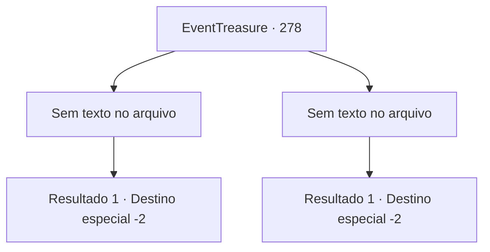

# Eventos de tesouro · 278

[Índice da tabela](index.md) · [Índice geral](../index.md)

ID: `pt:EventTreasure:278` · Fonte: `EventTreasure4` · Versão: 1.2.47.

Mapeamento estático dos arquivos; a disponibilidade e a execução dependem do estado da run.

## Texto do evento

*Sem texto no arquivo.*

## Dados de entrada

```json
{
  "id": 278,
  "grade": 1,
  "place": "",
  "required": ""
}
```

## Mapa das escolhas



## Escolhas e resultados

### Escolha 1

*Sem texto no arquivo; o papel dessa opção depende da interface do jogo.*

Requisitos e outros campos da escolha:

```json
{
  "required": ""
}
```

#### Resultado 1.1

Você derrotou com sucesso o enorme demônio, fazendo com que ele se dissipe como neblina e se funda com você. Em seguida, a água te empurra para fora e, ao levantar a cabeça, uma nova vitalidade surge através do seu corpo. O sacerdote, usando um monóculo, junta as mãos e diz. 

 "Bom trabalho. Você passou no teste. Os deuses do Panteão te abençoarão."

 Após completar o teste, você se despede do sacerdote e deixa o Panteão.

Continuação registrada: [Destino especial `-2`](../destinos-especiais.md).

```json
{
  "required": "",
  "chance": "1",
  "nextEvent": -2,
  "type": 2,
  "reward": "27_36_1|5_544_9"
}
```

### Escolha 2

*Sem texto no arquivo; o papel dessa opção depende da interface do jogo.*

Requisitos e outros campos da escolha:

```json
{
  "required": ""
}
```

#### Resultado 2.1

Você foi empalado pela espada equilibrada pelo enorme demônio. Assustado, você foi empurrado para fora da água. Enquanto verifica seu corpo, você se alivia ao não encontrar nenhuma ferida. O padre que usa um monóculo tem uma expressão de arrependimento e fala. 

 "É lamentável. Você não passou no teste, mas não se preocupe muito. Os deuses sempre cuidarão de você. Desejo-lhe boa sorte."

 Tendo desistido do teste, você se despede do padre e deixa o Panteão.

Continuação registrada: [Destino especial `-2`](../destinos-especiais.md).

```json
{
  "required": "",
  "chance": "1",
  "nextEvent": -2,
  "type": 2,
  "reward": "5_544_9|0_1_-1"
}
```

## Referências que chegam a este evento

- [Evento 276 · escolha 1 · resultado 2](0276.md#escolha-1)
