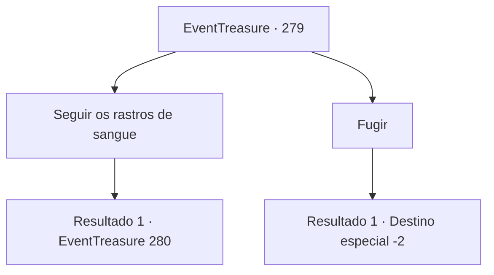

# Eventos de tesouro · 279

[Índice da tabela](index.md) · [Índice geral](../index.md)

ID: `pt:EventTreasure:279` · Fonte: `EventTreasure4` · Versão: 1.2.47.

Mapeamento estático dos arquivos; a disponibilidade e a execução dependem do estado da run.

## Texto do evento

Ao passar pela floresta morta cheia de árvores secas e mortas, você sentiu um forte cheiro de sangue no ar. Em pouco tempo, você encontra corpos de paladinos caídos. Os restos de uma batalha feroz estão espalhados por toda parte, e cada um deles é decapitado. Ao examinar a cena por um momento, você percebe que o rastro de sangue leva a outro lugar.

## Dados de entrada

```json
{
  "id": 279,
  "grade": 2,
  "place": "",
  "required": "26_20_1|5_546_0|1_2_50|2_3_-14"
}
```

## Mapa das escolhas



## Escolhas e resultados

### Escolha 1

Seguir os rastros de sangue

Requisitos e outros campos da escolha:

```json
{
  "required": ""
}
```

#### Resultado 1.1

Siga as manchas de sangue seco do cavaleiro caído através da floresta, o que o leva a uma caverna escura. Ao entrar na caverna, uma figura encapuzada com olhos afundados e aparência debilitada aparece diante de você. Seus olhos piscam loucamente. 

 "Quem é você? Você também é um paladino?"

 O homem perturbado olha para você por um momento antes de retrair suas próprias palavras. 

 "Não... você não é. Mas você cheira como eu. O que você é?"


Continuação registrada: [Evento 280](0280.md) na mesma tabela.

```json
{
  "required": "",
  "chance": "1",
  "nextEvent": 280,
  "type": 2,
  "reward": "5_546_1"
}
```

### Escolha 2

Fugir

Requisitos e outros campos da escolha:

```json
{
  "required": ""
}
```

#### Resultado 2.1

Você rapidamente vira as costas para os cadáveres e foge correndo, fazendo uma fuga rápida.

Continuação registrada: [Destino especial `-2`](../destinos-especiais.md).

```json
{
  "required": "",
  "chance": "1",
  "nextEvent": -2,
  "type": 2,
  "reward": "5_546_9"
}
```

## Referências que chegam a este evento

Nenhum `nextEvent` positivo da mesma tabela aponta para este nó. Isso não prova que seja inacessível: sorteio e estado de história podem selecioná-lo.

