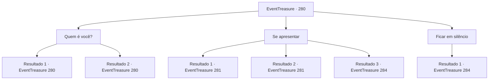

# Eventos de tesouro · 280

[Índice da tabela](index.md) · [Índice geral](../index.md)

ID: `pt:EventTreasure:280` · Fonte: `EventTreasure4` · Versão: 1.2.47.

Mapeamento estático dos arquivos; a disponibilidade e a execução dependem do estado da run.

## Texto do evento

*Sem texto no arquivo.*

## Dados de entrada

```json
{
  "id": 280,
  "grade": 1,
  "place": "",
  "required": ""
}
```

## Mapa das escolhas



## Escolhas e resultados

### Escolha 1

Quem é você?

Requisitos e outros campos da escolha:

```json
{
  "required": "5_547_0"
}
```

#### Resultado 1.1

Ele responde à sua pergunta com um tom orgulhoso, 

 "Eu sou seguidor de 'Grimora'. Me chamam de 'Al Harmutt'."

 Parece que ele assume que você deveria conhecer naturalmente a Grimora. No entanto, você não está familiarizado/a com Grimora e apenas acena vagamente com a cabeça.

Continuação registrada: [Evento 280](0280.md) na mesma tabela.

```json
{
  "required": "2_7_10",
  "chance": "1",
  "nextEvent": 280,
  "type": 2,
  "reward": "5_547_1"
}
```

#### Resultado 1.2

Ele responde à sua pergunta com um tom orgulhoso, 

 "Eu sou seguidor de 'Grimora'. Me chamam de 'Al Harmutt'."

 Parece que ele assume que naturalmente você deveria conhecer Grimora. Você reflete profundamente, lembrando do que ouviu sobre Grimora. Grimora é conhecido como o 'Grande Demônio do Sangue e do Terror', uma criatura monstruosa com cabeça de carneiro gigante, pescoço de girafa e corpo de gorila, com cauda de crocodilo. Mesmo entre os demônios, Grimora é famoso por sua natureza feroz, matando sem hesitar os de sua própria espécie.

Continuação registrada: [Evento 280](0280.md) na mesma tabela.

```json
{
  "required": "1_7_10",
  "chance": "1",
  "nextEvent": 280,
  "type": 2,
  "reward": "5_547_1"
}
```

### Escolha 2

Se apresentar

Requisitos e outros campos da escolha:

```json
{
  "required": "5_547_1"
}
```

#### Resultado 2.1

Você se apresenta e ele responde com um som de 'Ah', sabendo, concordando com a cabeça. 

 "Hmm! Sim, já ouvi seu nome antes. Você é um aventureiro bastante habilidoso, não é? Devo dizer que é uma sorte de timing. Acabei de adquirir uma oferta para apresentar a Grimora. Você também terá a oportunidade de receber bênçãos da grande entidade."


Continuação registrada: [Evento 281](0281.md) na mesma tabela.

```json
{
  "required": "18_432_1|21_3_0",
  "chance": "1",
  "nextEvent": 281,
  "type": 2,
  "reward": ""
}
```

#### Resultado 2.2

Você se apresenta e ele responde com um som de 'Ah', sabendo, concordando com a cabeça. 

 "Hmm! Sim, isso está correto. Já ouvi falar de você. Você serve ao príncipe demônio 'Kior', não é?"

 Ele parece pensar que você é alguém em uma posição semelhante à dele e faz gestos para que você o siga com uma expressão séria. 

 "É uma sorte o momento. Acabei de adquirir uma oferenda para apresentar a Grimora. Vamos compartilhar a oferenda. Certamente Kior ficará satisfeito."


Continuação registrada: [Evento 281](0281.md) na mesma tabela.

```json
{
  "required": "5_432_1",
  "chance": "1",
  "nextEvent": 281,
  "type": 2,
  "reward": ""
}
```

#### Resultado 2.3

Você se apresenta e ele responde com um som de 'Ah', sabendo, concordando com a cabeça. 

 "Hmm! Sim, já ouvi seu nome antes. Você é um aventureiro bastante habilidoso, não é? Devo dizer que é uma sorte de timing. Acabei de adquirir uma oferta para apresentar a Grimora. Concedo a você a gloriosa oportunidade de se dedicar a Ele também."

 Em resposta ao seu gesto, o espaço se distorce e demônios, exalando um cheiro fétido de sangue em decomposição, emergem. São os temidos Hezrou.

Continuação registrada: [Evento 284](0284.md) na mesma tabela.

```json
{
  "required": "18_432_1|20_3_0",
  "chance": "1",
  "nextEvent": 284,
  "type": 2,
  "reward": "6_3_152",
  "place": 6
}
```

### Escolha 3

Ficar em silêncio

Requisitos e outros campos da escolha:

```json
{
  "required": ""
}
```

#### Resultado 3.1

Você permaneceu em silêncio, e ele examinou intensamente o seu rosto. Dando um passo para trás, ele libera uma energia escura e grita abruptamente, 

 "Arrogante insolente! Morra!"

 Em resposta ao seu gesto, o espaço se distorce e demônios, exalando um cheiro fétido de sangue podre, emergem. São os temidos Hezrou.

Continuação registrada: [Evento 284](0284.md) na mesma tabela.

```json
{
  "required": "",
  "chance": "1",
  "nextEvent": 284,
  "type": 2,
  "reward": "6_3_152",
  "place": 6
}
```

## Referências que chegam a este evento

- [Evento 279 · escolha 1 · resultado 1](0279.md#escolha-1)
- [Evento 280 · escolha 1 · resultado 1](0280.md#escolha-1)
- [Evento 280 · escolha 1 · resultado 2](0280.md#escolha-1)
