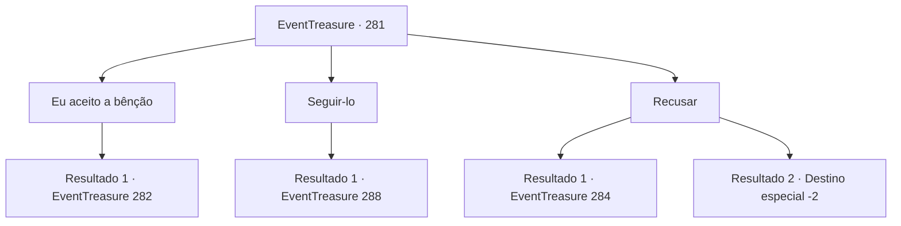

# Eventos de tesouro · 281

[Índice da tabela](index.md) · [Índice geral](../index.md)

ID: `pt:EventTreasure:281` · Fonte: `EventTreasure4` · Versão: 1.2.47.

Mapeamento estático dos arquivos; a disponibilidade e a execução dependem do estado da run.

## Texto do evento

*Sem texto no arquivo.*

## Dados de entrada

```json
{
  "id": 281,
  "grade": 1,
  "place": "",
  "required": ""
}
```

## Mapa das escolhas



## Escolhas e resultados

### Escolha 1

Eu aceito a bênção

Requisitos e outros campos da escolha:

```json
{
  "required": "18_432_1"
}
```

#### Resultado 1.1

Você disse que aceitaria a bênção de Grimora. Ao ouvir isso, Al Harmutt sorriu amplamente e te guiou mais fundo na caverna. Enquanto o seguia, você notou ossos e carne em decomposição espalhados pelo chão, os quais você afastou aproximadamente do seu caminho. Após cerca de quinze minutos de caminhada, você chega à parte mais profunda da caverna. Lá, em uma área ligeiramente maior que os corredores, há um altar feito de ossos. Al Harmutt coloca as cabeças dos cavaleiros no altar e as acende em chamas, então se prostra no chão. As chamas queimam com um brilho verde inquietante, enchendo a caverna com gritos agonizantes.

Continuação registrada: [Evento 282](0282.md) na mesma tabela.

```json
{
  "required": "",
  "chance": "1",
  "nextEvent": 282,
  "type": 2,
  "reward": ""
}
```

### Escolha 2

Seguir-lo

Requisitos e outros campos da escolha:

```json
{
  "required": "5_432_1"
}
```

#### Resultado 2.1

Você aceitou a oferta dele. Um largo sorriso se desenhou no rosto de Harmutt e ele te guiou mais fundo na caverna. Enquanto o seguia, você notou ossos e carne em decomposição espalhados por ali, os quais você afastou aproximadamente do seu caminho. Após cerca de quinze minutos de caminhada, você chega à parte mais profunda da caverna. Lá, em uma área ligeiramente maior que os corredores, há um altar feito de ossos. 

 "Ok. Aqui, eu te entrego essas cabeças de paladinos, ofereça-as. Eu, do meu jeito, realizarei um ritual para Grimora."


Continuação registrada: [Evento 288](0288.md) na mesma tabela.

```json
{
  "required": "",
  "chance": "1",
  "nextEvent": 288,
  "type": 2,
  "reward": ""
}
```

### Escolha 3

Recusar

Requisitos e outros campos da escolha:

```json
{
  "required": ""
}
```

#### Resultado 3.1

Você rejeita a oferta dele. Ao ouvir isso, ele faz uma careta e recua, liberando uma energia escura e gritando abruptamente, 

 "Garoto arrogante! Morra!"

 Em resposta ao seu gesto, o espaço se distorce e demônios, exalando um cheiro fétido de sangue podre, emergem. São os temidos Hezrou.

Continuação registrada: [Evento 284](0284.md) na mesma tabela.

```json
{
  "required": "18_432_1",
  "chance": "1",
  "nextEvent": 284,
  "type": 2,
  "reward": "6_3_152",
  "place": 6
}
```

#### Resultado 3.2

Você rejeita a oferta dele. Ele assente com a cabeça e desaparece nas profundezas da caverna.

Continuação registrada: [Destino especial `-2`](../destinos-especiais.md).

```json
{
  "required": "5_432_1",
  "chance": "1",
  "nextEvent": -2,
  "type": 2,
  "reward": "5_546_9"
}
```

## Referências que chegam a este evento

- [Evento 280 · escolha 2 · resultado 1](0280.md#escolha-2)
- [Evento 280 · escolha 2 · resultado 2](0280.md#escolha-2)
