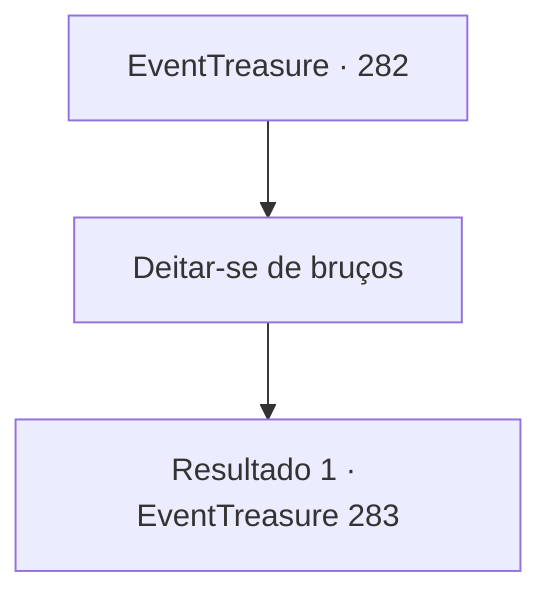

# Eventos de tesouro · 282

[Índice da tabela](index.md) · [Índice geral](../index.md)

ID: `pt:EventTreasure:282` · Fonte: `EventTreasure4` · Versão: 1.2.47.

Mapeamento estático dos arquivos; a disponibilidade e a execução dependem do estado da run.

## Texto do evento

*Sem texto no arquivo.*

## Dados de entrada

```json
{
  "id": 282,
  "grade": 1,
  "place": "",
  "required": ""
}
```

## Mapa das escolhas



## Escolhas e resultados

### Escolha 1

Deitar-se de bruços

Requisitos e outros campos da escolha:

```json
{
  "required": ""
}
```

#### Resultado 1.1

Você está deitado no chão úmido da caverna, água e sangue se acumulam ao seu redor. Uma voz surge das chamas verdes. 

 "O que você sacrificará pelo poder? O que me dará em troca?"


Continuação registrada: [Evento 283](0283.md) na mesma tabela.

```json
{
  "required": "",
  "chance": "1",
  "nextEvent": 283,
  "type": 2,
  "reward": ""
}
```

## Referências que chegam a este evento

- [Evento 281 · escolha 1 · resultado 1](0281.md#escolha-1)
